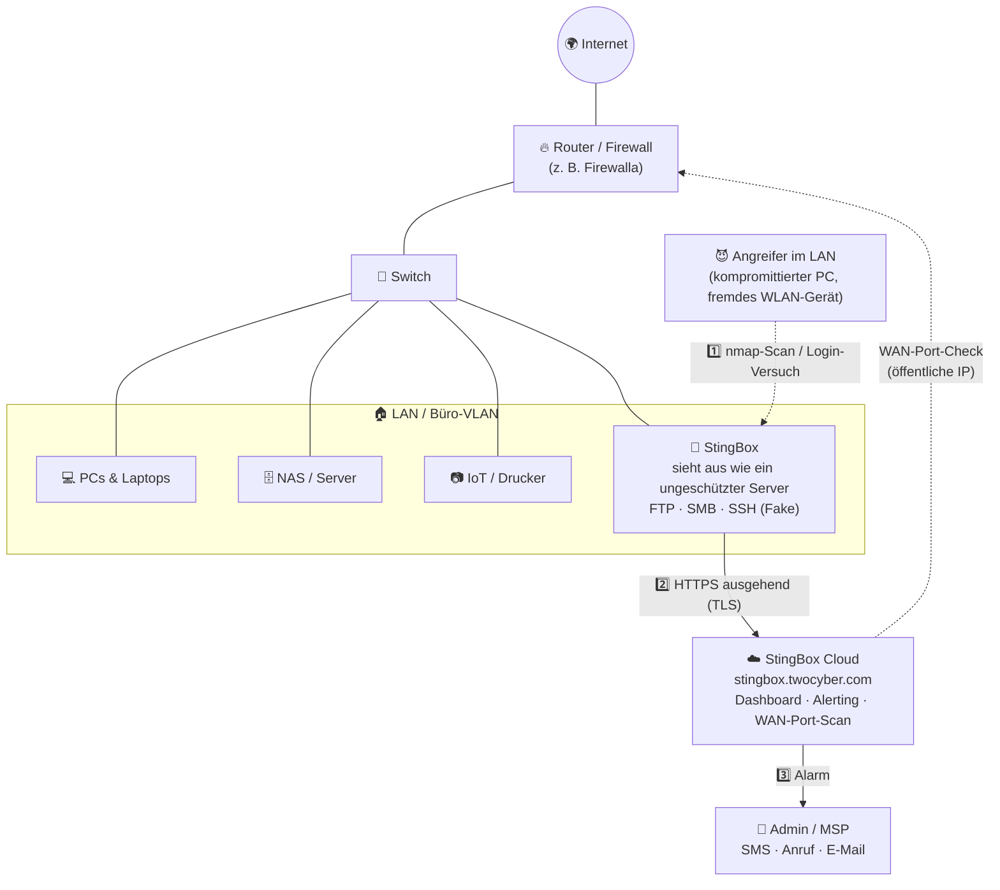

# 🐝 StingBox – ehrlich erklärt

### Was der kleine Honeypot-Alarm wirklich kann, was er **nicht** ist – und für wen sich das Abo lohnt

*Ein didaktisches, herstellerunabhängiges Handbuch über [StingBox](https://www.stingbox.com/) (StingBox LLC, Florida): Technik, Preise, Datenschutz, Alternativen und die Einbindung in ein Firewalla-Gold-Pro-/Proxmox-Security-Lab.*

---

> [!IMPORTANT]
> **Ehrlichkeits-Versprechen:** Dieses Repository ist **keine Werbung**, enthält **keine Affiliate-Links** und hat **keine Verbindung** zu StingBox LLC. Wir besitzen (Stand heute) **kein eigenes Gerät** – alle Aussagen beruhen auf **Herstellerseiten mit Link**, **unabhängigen Community-Berichten mit Link** oder sind **ausdrücklich als ⚠️ Schätzung / Annahme / unverifiziert** markiert. Kundenzitate auf der Herstellerseite zählen für uns **nicht** als Beleg. Recherchestand: **13. Oktober 2026**. Preise und Features ändern sich – vor dem Kauf selbst prüfen. Die Schattenseiten stehen im [🔍 Reality Check](docs/reality-check.md).

| Marker | Bedeutung |
|---|---|
| ✅ | Durch Primärquelle (Herstellerseite/-dokument) belegt |
| 🟦 | Durch unabhängige Quelle (Forum, Review, Reddit) belegt – Einzelmeinung möglich |
| ⚠️ | Unverifiziert, widersprüchlich, veraltet oder eigene Schätzung/Ableitung |
| ❌ | Trifft laut Quelle **nicht** zu |

> 🤝 **Companion-Repositories:** [node300-net/firewalla-gold-pro-msp](https://github.com/node300-net/firewalla-gold-pro-msp) (Perimeter-Firewall) · [node300-net/sovereign-datacenter](https://github.com/node300-net/sovereign-datacenter) (4-Node-Proxmox-Security-Lab mit Cowrie & Suricata). Hier geht es um die Frage: **Braucht dieses Setup zusätzlich eine StingBox – und wo gehört sie hin?** → [🔌 Integration](docs/integration.md)

## 📚 Inhaltsverzeichnis

- [🗺️ Repository-Struktur](#️-repository-struktur)
- [⚡ TL;DR](#-tldr)
- [🐝 Was StingBox ist (verifiziert)](#-was-stingbox-ist-verifiziert)
- [🚫 Was StingBox NICHT ist](#-was-stingbox-nicht-ist)
- [💰 Preise auf einen Blick](#-preise-auf-einen-blick)
- [🌐 Platzierung im Heim-/KMU-Netz](#-platzierung-im-heim-kmu-netz)
- [🎯 Für wen lohnt es sich?](#-für-wen-lohnt-es-sich)
- [🧮 Entscheidungsmatrix](#-entscheidungsmatrix)
- [⚖️ Fazit](#️-fazit)
- [📖 Quellen](#-quellen)
- [📜 Lizenz](#-lizenz)

---

## 🗺️ Repository-Struktur

| Pfad | Inhalt |
|---|---|
| [`docs/what-it-is.md`](docs/what-it-is.md) | Funktionsweise: Honeypot-Dienste, HackerCam, LAN-Discovery, WAN-Port-Scan, Alerting, Hardware, Virtual, Cloud-Endpunkte, Firma |
| [`docs/what-it-is-not.md`](docs/what-it-is-not.md) | Abgrenzung: keine Firewall, kein IPS, kein klassisches NIDS, kein Antivirus, kein EDR, kein SIEM, kein Schwachstellenscanner |
| [`docs/who-should-buy.md`](docs/who-should-buy.md) | Personas: Privatnutzer, Familie, Homelabber, KMU, MSP, Red/Blue Teamer – mit Entscheidungsbaum |
| [`docs/alternatives.md`](docs/alternatives.md) | Ehrlicher Vergleich: Thinkst Canary, OpenCanary, Canarytokens.org, T-Pot, Cowrie, Firewalla-Alarme – inkl. 3-/5-Jahres-Kosten |
| [`docs/reality-check.md`](docs/reality-check.md) | Grenzen & Risiken: Cloud-Zwang, Mietgerät, altes OS, 10/100-Hardware, Hersteller-SSH-Key, Alert-Latenz, Widersprüche |
| [`docs/integration.md`](docs/integration.md) | Einbindung in Firewalla Gold Pro + Huawei S220S + Zyxel GS1900 + Proxmox (Cowrie Node 1, Suricata/Syslog Node 3) |
| [`configs/`](configs/README.md) | Beispiel: StingBox-API → rsyslog-Poller für Node 3, Firewalla-Regelkonzept, Suricata-„Tripwire“-Regel |
| `LICENSE` | MIT (Code/Configs) + CC BY-SA 4.0 (Dokumentation) |
| `CONTRIBUTING.md` | Kurzleitfaden für Beiträge |

---

## ⚡ TL;DR

| 💡 Frage | Kurzantwort | Beleg |
|---|---|---|
| **Was ist es?** | Ein **Low-Interaction-Honeypot** als Mini-Gerät (oder VM/Docker), der Alarm schlägt, wenn ihn jemand im LAN **scannt, anspricht oder sich einloggt** – wie ein Bewegungsmelder im Flur. ✅ | [Startseite](https://www.stingbox.com/): *„simple low interaction honeypot and network intrusion alarm“* |
| **Stoppt es Angreifer?** | **Nein.** ❌ Reine Erkennung. | [FAQ](https://www.stingbox.com/faq/): *„Does StingBox stop hackers? No.“* |
| **Kosten?** | **25 $/Monat** oder **200 $/Jahr**, plus **50 $** Gerätegebühr. **Nur als Abo** – kein Kauf möglich. ✅ | [Preise](https://www.stingbox.com/order/) · [FAQ](https://www.stingbox.com/faq/) |
| **Gehört mir das Gerät?** | **Nein.** Es bleibt Eigentum von StingBox und muss bei Kündigung **zurückgeschickt** werden – sonst läuft das Abo weiter. ✅ | [Terms](https://www.stingbox.com/terms/) |
| **Cloud nötig?** | **Ja.** Dashboard, Alarme und Updates laufen über `stingbox.twocyber.com`. ✅ | [FAQ – Outbound Requirements](https://www.stingbox.com/faq/) |
| **Stärken** | 5-Minuten-Setup, SMS/**Anruf**/Mail, Webhook, Syslog (CEF), API, Multi-Site-Dashboard, White-Label für MSPs. ✅ | [Setup](https://www.stingbox.com/setup/) · [MSP](https://www.stingbox.com/msp/) |
| **Schwächen** | Mietmodell, Cloud-Zwang, schwache/alte Hardware-/OS-Angaben, 1 Netzwerkinterface (1 Box pro Segment für LAN-Discovery), wenig unabhängige Tests. ⚠️ | [Reality Check](docs/reality-check.md) |
| **Für wen?** | **KMU/Praxen/Kanzleien ohne Security-Team** und **MSPs**. Für Homelabber & Profis sind **OpenCanary/Canarytokens** meist die bessere Wahl. | [Personas](docs/who-should-buy.md) |

---

## 🐝 Was StingBox ist (verifiziert)

| Merkmal | Angabe | Quelle | Status |
|---|---|---|---|
| **Produktkategorie** | Low-Interaction-Honeypot + „network intrusion alarm“ | [Startseite](https://www.stingbox.com/) | ✅ |
| **Simulierte Dienste** | „Set of services which simulate standard services of a networked host/device (FTP, SMB, etc)“ | [Security White Paper 2021, S. 5](https://www.stingbox.com/wp-content/uploads/2024/06/Whitepaper-US-1.36-2021.pdf) | ✅ (Stand 2021) |
| **HackerCam** | Zeichnet Tastatureingaben in einer Fake-SSH-Root-Shell auf, schickt Link zu „Video“ + KI-Zusammenfassung | [Startseite](https://www.stingbox.com/) · [FAQ](https://www.stingbox.com/faq/) | ✅ |
| **LAN-Discovery** | Ping- + ARP-Scan alle **5 Minuten**, „New Device“-Alarme | [FAQ](https://www.stingbox.com/faq/) | ✅ |
| **SMB-Share-Scan** | Opt-in; versucht Login als `root` mit leerem Passwort auf Shares | [FAQ](https://www.stingbox.com/faq/) | ✅ |
| **WAN-Port-Alarm** | Meldet **neu geöffnete Ports** auf der öffentlichen IP | [Startseite](https://www.stingbox.com/) · [Preise](https://www.stingbox.com/order/) | ✅ |
| **Alarmkanäle** | E-Mail, SMS, Sprachanruf, Webhook (JSON POST), Syslog (TCP, CEF), API (Pull) | [Startseite](https://www.stingbox.com/) · [FAQ](https://www.stingbox.com/faq/) | ✅ |
| **Disconnect-Alarm** | Alarm, wenn die Box offline geht | [Startseite](https://www.stingbox.com/) | ✅ |
| **Hardware** | Allwinner-H2-SoC, Quad-Core Cortex-A7, **512 MB RAM**, **10/100-Ethernet**, 8 GB microSD, WLAN deaktiviert | [White Paper 2021, S. 4](https://www.stingbox.com/wp-content/uploads/2024/06/Whitepaper-US-1.36-2021.pdf) · [FAQ](https://www.stingbox.com/faq/) | ✅ (Stand 2021) ⚠️ aktuelle Revision unbekannt |
| **Betriebssystem** | Ubuntu 16.04.7 LTS (armv7l), „Security Patches/Updates nightly“ | [White Paper 2021, S. 4](https://www.stingbox.com/wp-content/uploads/2024/06/Whitepaper-US-1.36-2021.pdf) | ⚠️ Stand 2021, heute unklar |
| **Virtual** | Linux-Host/VPS/Cloud via Install-Skript, Docker via privatem Repo; Ubuntu 20.04, 8 GB Disk, 4 GB+ RAM | [Virtual](https://www.stingbox.com/virtual/) | ✅ |
| **Firma** | StingBox LLC, Stuart, Florida (USA) | [Kontakt](https://www.stingbox.com/contact/) | ✅ |

Mehr Details: **[docs/what-it-is.md](docs/what-it-is.md)**

---

## 🚫 Was StingBox NICHT ist

| ❌ Nicht … | Warum? | Beleg |
|---|---|---|
| 🔥 **Firewall** | Filtert keinen Verkehr, sitzt nicht inline | [Virtual-Disclaimer](https://www.stingbox.com/virtual/): *„not a replacement for good firewalls“* ✅ |
| 🛑 **IPS / NIPS** | Blockiert nichts | [FAQ](https://www.stingbox.com/faq/): *„Stingbox is not a NIPS … just a Honeypot.“* ✅ |
| 👁️ **Klassisches NIDS (Suricata/Zeek)** | Analysiert **nicht** den Netzwerkverkehr anderer Geräte – sieht nur, was **an sie selbst** geht (plus eigene Scans) | Ableitung aus [White Paper](https://www.stingbox.com/wp-content/uploads/2024/06/Whitepaper-US-1.36-2021.pdf) & [FAQ](https://www.stingbox.com/faq/) ⚠️ |
| 🦠 **Antivirus** | Kein Schutz auf Endgeräten | [Virtual-Disclaimer](https://www.stingbox.com/virtual/) ✅ |
| 🧬 **EDR/XDR** | Keine Telemetrie von Hosts; Hersteller empfiehlt zusätzlich Endpoint Security | [FAQ](https://www.stingbox.com/faq/) ✅ |
| 🛡️ **Garantie „nicht gehackt“** | Bleibt ein Angreifer auf einem Host, sieht StingBox ihn „likely“ nicht | [FAQ](https://www.stingbox.com/faq/) ✅ |

Mehr: **[docs/what-it-is-not.md](docs/what-it-is-not.md)**

---

## 💰 Preise auf einen Blick

| Plan | Preis | Erstzahlung | Quelle | Status |
|---|---|---|---|---|
| **Monthly (Hardware)** | **25 $/Monat** | 75 $ (1 Monat + 50 $ Gerät) | [Order](https://www.stingbox.com/order/) | ✅ |
| **Yearly (Hardware)** | **200 $/Jahr** („save 33%“) | 250 $ (1 Jahr + 50 $ Gerät) | [Order](https://www.stingbox.com/order/) | ✅ |
| **Virtual Monthly / Yearly** | **25 $/Monat** bzw. **200 $/Jahr** | ohne Gerätegebühr | [Virtual](https://www.stingbox.com/virtual/) | ✅ |
| **Volume** | **900 $/Jahr**, min. **5 Geräte**, 20 $ Gerätegebühr je Hardware-Box, Custom Branding | – | [Order](https://www.stingbox.com/order/) | ✅ Preis · ⚠️ ob 900 $ für genau 5 Boxen gilt, ist nicht eindeutig formuliert |
| **Kauf ohne Abo** | **nicht möglich** | – | [FAQ](https://www.stingbox.com/faq/) | ❌ |
| **Internationaler Versand** | nur bei **Jahresabos** | – | [FAQ](https://www.stingbox.com/faq/) | ✅ |

> 🧮 **3 / 5 Jahre (1 Hardware-Box, Yearly):** 650 $ / 1'050 $ – zzgl. Versand, Zoll, MWST (⚠️ für CH/FL nicht ausgewiesen). Monthly: 950 $ / 1'550 $. Vergleich mit Thinkst Canary (7'500 $/Jahr für 5) und kostenlosen Alternativen: **[docs/alternatives.md](docs/alternatives.md#-kosten-über-3--5-jahre)**.

---

## 🌐 Platzierung im Heim-/KMU-Netz

Ein Honeypot ist nur dann wertvoll, wenn **legitim niemand mit ihm redet**. Jede Verbindung ist dann ein starkes Signal – „high fidelity, low noise“. Darum gehört er **nach innen**, nicht ins Internet.

| ✅ Gute Orte | ⚠️ Fragwürdige Orte | ❌ Schlechte Orte |
|---|---|---|
| Büro-/Haupt-LAN, Server-VLAN, Management-VLAN (wenn Internet-Ausgang erlaubt) | Gast-WLAN (viel Rauschen), Red-Team-Lab (Fehlalarme) | **Direkt im Internet / per Port-Forward** – dann klingelt es im Minutentakt und der Alarm wird wertlos |

> 💡 Laut FAQ reicht **eine Box**, solange sie für Angreifer **erreichbar** ist; die **LAN-Discovery** (ARP/Ping) funktioniert aber nur im **eigenen Subnetz**, und es gibt nur **ein Netzwerkinterface** ([FAQ](https://www.stingbox.com/faq/)). Ein MSP auf Reddit fand genau das „underwhelming“: *„you need a separate box for each vlan / subnet“* 🟦 ([r/msp](https://www.reddit.com/r/msp/comments/13vcp77/anyone_use_sting_box/)).

---

## 🎯 Für wen lohnt es sich?

| Persona | Urteil | Begründung in einem Satz |
|---|---|---|
| 👤 **Privatnutzer** | ❌ eher nicht | 200 $/Jahr für ein seltenes Ereignis; [Canarytokens.org](https://canarytokens.org/) gibt’s gratis |
| 👨‍👩‍👧 **Familie** | ⚠️ selten | Angriffe im Heim-LAN laufen meist über Phishing/Endgeräte – Updates, MFA, gute Firewall bringen mehr |
| 🧪 **Homelabber** | ❌ / ⚠️ | Lernwert höher mit **OpenCanary/Cowrie/T-Pot** selbst gebaut; StingBox nur, wenn „null Pflege“ zählt |
| 🏢 **KMU ohne Security-Team** | ✅ **Sweet Spot** | Einstecken, Handynummer hinterlegen, fertig – ein bezahlbarer „Einbruchmelder“ für das LAN |
| 🧰 **MSP / MSSP** | ✅ | Multi-Tenant-Dashboard, API/Webhook/Syslog, White-Label ab 5 Stück |
| 🔴 **Red Teamer** | ⚠️ | Als **Ziel/Übungsgegner** interessant (Wie leise kann ich sein?) |
| 🔵 **Blue Teamer** | ⚠️ | Funktioniert, aber Thinkst Canary oder OpenCanary bieten mehr Kontrolle/Personas |

Ausführlich mit Entscheidungsbaum: **[docs/who-should-buy.md](docs/who-should-buy.md)**

---

## 🧮 Entscheidungsmatrix

Bewertung: 🟢 passt gut · 🟡 bedingt · 🔴 passt schlecht. ⚠️ Gewichtung ist **unsere Einschätzung**, keine Messung.

| Kriterium | 🐝 StingBox | 🐦 Thinkst Canary | 🐤 OpenCanary | 🪤 Canarytokens.org | 🍯 T-Pot | 🐚 Cowrie | 🔥 Firewalla-Alarme |
|---|---|---|---|---|---|---|---|
| Einrichtung ohne Fachwissen | 🟢 | 🟢 | 🔴 | 🟢 | 🔴 | 🔴 | 🟢 |
| Laufende Kosten | 🟡 ~200 $/J. | 🔴 7'500 $/J. (5 Stk.) | 🟢 0 $ | 🟢 0 $ | 🟢 0 $ (+HW) | 🟢 0 $ | 🟢 im Kaufpreis |
| Interner LAN-Tripwire | 🟢 | 🟢 | 🟢 | 🟡 (Token-basiert) | 🟡 (eher Internet-Sensor) | 🟡 (nur SSH/Telnet) | 🟡 (nur Verkehr durch die Box) |
| SMS / Telefonanruf | 🟢 | 🟢 SMS | 🔴 (selbst bauen) | 🔴 Mail/Webhook | 🔴 | 🔴 | 🟢 Push |
| Ohne Hersteller-Cloud | 🔴 | 🔴 | 🟢 | 🔴 (öffentlicher Dienst) / 🟢 self-hosted | 🟢 | 🟢 | 🟡 |
| Personas / Tiefe der Täuschung | 🟡 | 🟢 | 🟡 | 🟡 | 🟢 | 🟢 SSH | 🔴 kein Honeypot |
| Multi-Site / MSP | 🟢 | 🟢 | 🔴 | 🔴 | 🟡 | 🔴 | 🟢 (MSP) |
| Gerät gehört dir | 🔴 Miete | 🔴 Miete ⚠️ | 🟢 | – | 🟢 | 🟢 | 🟢 |

Quellen & Details zu jeder Zelle: **[docs/alternatives.md](docs/alternatives.md)**

---

## ⚖️ Fazit

> **StingBox ist ein ehrliches, simples Produkt – kein Wundermittel.** Es macht genau eine Sache: Es schlägt Alarm, wenn sich jemand im Netz umschaut, wo er nichts zu suchen hat. Für ein KMU ohne IT-Security-Personal ist das für **~17 $/Monat (Jahresabo)** ein vernünftiger, leicht erklärbarer Baustein („Einbruchmelder fürs Netzwerk“).
>
> **Aber:** Du **mietest** ein Gerät mit schwacher Hardware (Stand Whitepaper 2021: 512 MB RAM, 10/100-Ethernet, Ubuntu 16.04), bist **vollständig von der Hersteller-Cloud abhängig** und es gibt **kaum unabhängige technische Tests**. Wer Linux kann, bekommt mit **OpenCanary + Canarytokens** einen Grossteil des Nutzens gratis – und behält die Daten im eigenen Netz.
>
> **Für das node300-Lab** (Firewalla Gold Pro + Cowrie + Suricata): **Nice-to-have, kein Muss.** Sinnvoll vor allem als **Evaluation für MSP-Kunden** oder wenn SMS/Anruf-Alarme ohne Eigenbau gewünscht sind. Siehe [🔌 Integration](docs/integration.md).

---

## 📖 Quellen

| Thema | Quelle |
|---|---|
| Startseite (Produktbeschreibung, HackerCam, Alerts, Virtual, API/Webhook/Syslog) | <https://www.stingbox.com/> |
| Preise | <https://www.stingbox.com/order/> |
| FAQ (Outbound-Endpunkte, Hardware, Abo-Pflicht, NIPS-Abgrenzung, Webhook/Syslog, Datenerhebung) | <https://www.stingbox.com/faq/> |
| Setup-Anleitung | <https://www.stingbox.com/setup/> |
| StingBox Virtual | <https://www.stingbox.com/virtual/> |
| MSP-Programm | <https://www.stingbox.com/msp/> |
| Security White Paper V1.36 (Juni 2021) | <https://www.stingbox.com/wp-content/uploads/2024/06/Whitepaper-US-1.36-2021.pdf> |
| API-Dokumentation (Jan. 2026) | <https://stingbox.twocyber.com/api_doc/StingBoxAPIDocumentation.pdf> |
| Terms & Conditions | <https://www.stingbox.com/terms/> |
| Privacy Policy | <https://www.stingbox.com/privacy/> |
| Kontakt / Firmenadresse | <https://www.stingbox.com/contact/> |
| Reddit r/msp „Anyone use sting box?“ | <https://www.reddit.com/r/msp/comments/13vcp77/anyone_use_sting_box/> |
| Reddit r/selfhosted „Sting Box Alternative“ (Jan. 2023) | <https://www.reddit.com/r/selfhosted/comments/10lcxc7/sting_box_alternative/> |
| Spiceworks Community (März 2022) | <https://community.spiceworks.com/t/stingbox/828286> |
| Lawrence Systems Forum (Sept. 2020) | <https://forums.lawrencesystems.com/t/stingbox-network-intrusion-alarm/6627> |
| Alternativen | siehe [docs/alternatives.md](docs/alternatives.md#-quellen) |

---

## 📜 Lizenz

- 🧑‍💻 **Code & Konfigurationen** (`configs/`, Skripte): **MIT** – siehe [LICENSE](LICENSE)
- 📝 **Dokumentation** (`README.md`, `docs/`): **CC BY-SA 4.0**
- ™️ „StingBox“, „Thinkst Canary“, „Canarytokens“, „Firewalla“, „Huawei“, „Zyxel“, „Proxmox“ sind Marken der jeweiligen Inhaber. Keine Affiliation.

**🐝 Ein Honeypot schützt nicht. Er verrät. Und genau das ist sein Wert.**

