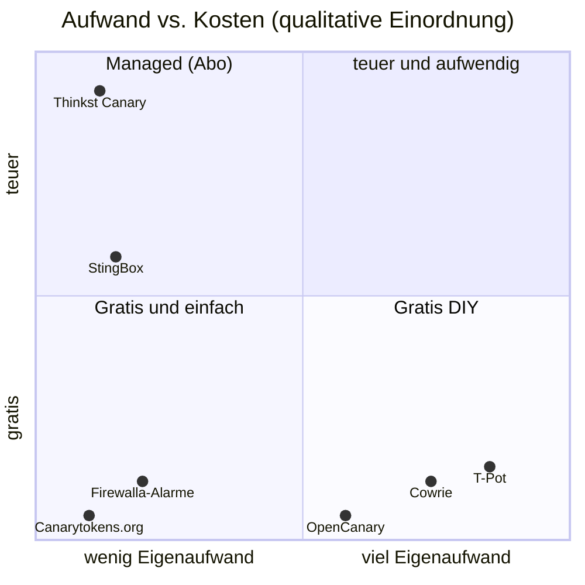

# 🔁 Alternativen – ehrlicher Vergleich

> Zurück zur [README](../README.md) · [🐝 Was es ist](what-it-is.md) · [🚫 Was es nicht ist](what-it-is-not.md) · [🎯 Für wen?](who-should-buy.md) · [🔍 Reality Check](reality-check.md) · [🔌 Integration](integration.md)

Recherchestand **13.10.2026**, Preise in **USD** ohne MWST/Versand/Zoll. ✅ Herstellerquelle · 🟦 unabhängige Quelle · ⚠️ Schätzung/Ableitung.

> [!NOTE]
> **Äpfel vs. Birnen:** Die Kandidaten lösen **verwandte, aber unterschiedliche** Probleme. StingBox, Thinkst Canary und OpenCanary sind **interne Tripwires**. Canarytokens sind **präparierte Köder-Daten**. T-Pot und Cowrie sind vor allem **Internet-Sensoren / Forschungs-Honeypots**. Firewalla-Alarme sind **Firewall-Telemetrie**, kein Honeypot.

---

## 🧭 Landkarte

> ⚠️ Positionen sind **unsere qualitative Einschätzung** zur Orientierung, keine Messwerte. „T-Pot teuer“ meint nur die nötige Hardware (16 GB RAM).

---

## 📊 Feature-Vergleich

| | 🐝 **StingBox** | 🐦 **Thinkst Canary** | 🐤 **OpenCanary** | 🪤 **Canarytokens.org** | 🍯 **T-Pot CE** | 🐚 **Cowrie** | 🔥 **Firewalla-Alarme** |
|---|---|---|---|---|---|---|---|
| **Typ** | Low-Interaction-Honeypot (HW/VM) | Kommerzieller Honeypot (HW/VM/Cloud) | Open-Source-Honeypot-Daemon | Köder-Tokens (Dateien, URLs, Keys …) | Multi-Honeypot-Plattform (20+ Honeypots) | SSH/Telnet-Honeypot (medium/high) | Firewall-Alarme (Port-Scan, SSH-Guessing, New Device …) |
| **Herausgeber** | StingBox LLC (USA) | Thinkst Applied Research | Thinkst (Open Source) | Thinkst (gratis Dienst + Open Source) | Deutsche Telekom Security | Community (M. Oosterhof) | Firewalla Inc. |
| **Lizenz** | proprietär, Abo | proprietär, Abo | BSD-3-Clause ✅ | Dienst gratis; Code Open Source ✅ | GPL-3.0 ✅ | BSD-3-Clause ✅ | im Box-Preis |
| **Simulierte Dienste** | FTP, SMB, SSH (Fake-Shell) u. a. ✅ | viele Personas (Windows, Linux, NAS, Router …) ✅ | FTP, HTTP(S), SSH, Telnet, SMB, MySQL, MSSQL, RDP, VNC, Redis, SIP, SNMP, TFTP, NTP, Git, Portscan … ✅ | – (Token-Typen) | 20+ Honeypots inkl. Cowrie ✅ | SSH, Telnet ✅ | – |
| **Alarmwege** | Mail, SMS, **Anruf**, Webhook, Syslog (CEF), API ✅ | Mail, SMS, Slack, Webhook, Syslog ✅ | Datei, Syslog, SMTP, Webhook, Slack, Teams ✅ | Mail, Webhook ✅ ⚠️ | Elastic/Kibana-Dashboards ✅ | JSON-Logs, Output-Plugins ✅ | App-Push, MSP, Webhook/API ✅ |
| **Cloud nötig?** | **ja** ✅ | ja (AWS-Konsole) ✅ | **nein** | ja (öffentlicher Dienst) / nein (self-hosted) | nein (ausser Community-Datenteilen, optional ⚠️) | nein | teilweise (App/MSP) |
| **Hardware** | Mini-ARM-Box, 512 MB ✅ | Appliance oder VM | Raspberry Pi / kleine VM ✅ | keine | **16 GB RAM / 256 GB SSD** (Hive) ✅ | kleine VM | vorhanden |
| **Hauptnutzen** | interner Alarm „für alle“ | interner Alarm „Enterprise“ | interner Alarm „DIY“ | Datenabfluss/Neugier erkennen | Threat Intel, Forschung | SSH-TTPs studieren | Perimeter-Sicht |

**Quellen:** StingBox → [what-it-is.md](what-it-is.md) · Thinkst Canary → [canary.tools](https://canary.tools/) · OpenCanary → [GitHub](https://github.com/thinkst/opencanary) / [Doku](https://opencanary.readthedocs.io/) / [Default-Config](https://github.com/thinkst/opencanary/blob/master/opencanary/data/settings.json) · Canarytokens → [canarytokens.org](https://canarytokens.org/) / [GitHub](https://github.com/thinkst/canarytokens) · T-Pot → [GitHub](https://github.com/telekom-security/tpotce) · Cowrie → [GitHub](https://github.com/cowrie/cowrie) · Firewalla → [Handling Specific Alarms](https://help.firewalla.com/hc/en-us/articles/48455312216595-Handling-Specific-Firewalla-Alarms)

---

## 💰 Kosten über 3 & 5 Jahre

Annahme: **1 Sensor** (bzw. bei Thinkst das kleinste öffentliche Paket = 5 Sensoren). Ohne Strom, Arbeitszeit, MWST.

| Lösung | Jahr 1 | 3 Jahre | 5 Jahre | Herleitung | Status |
|---|---|---|---|---|---|
| 🐝 StingBox **Yearly** (HW) | 250 $ | **650 $** | **1'050 $** | 250 + 200/Folgejahr ([Order](https://www.stingbox.com/order/)) | ✅ |
| 🐝 StingBox **Monthly** (HW) | 350 $ | **950 $** | **1'550 $** | 75 + 11×25, danach 300/Jahr | ✅ gerechnet |
| 🐝 StingBox **Virtual Yearly** | 200 $ | **600 $** | **1'000 $** | + eigene VM ([Virtual](https://www.stingbox.com/virtual/)) | ✅ |
| 🐝 StingBox **Volume (5 HW)** | 1'000 $ | **2'800 $** | **4'600 $** | 900/Jahr + 5×20 $ Gerät ([Order](https://www.stingbox.com/order/)) | ⚠️ Annahme: 900 $ deckt genau 5 Boxen |
| 🐦 Thinkst Canary (5 Stk.) | 7'500 $ | **22'500 $** | **37'500 $** | 7'500 $/Jahr für 5 ([canary.tools](https://canary.tools/)) | ✅ Listenpreis |
| 🐤 OpenCanary auf Raspberry Pi | ~80 $ | **~80 $** | **~80–160 $** | ⚠️ Schätzung Pi + Netzteil + SD; evtl. Ersatz-SD | ⚠️ |
| 🐤 OpenCanary als LXC/VM auf Proxmox | 0 $ | **0 $** | **0 $** | vorhandene Hardware | ✅ Lizenz 0 $ |
| 🪤 Canarytokens.org | 0 $ | **0 $** | **0 $** | gratis Dienst | ✅ |
| 🍯 T-Pot (VM, vorhandener Host) | 0 $ | **0 $** | **0 $** | braucht 16 GB RAM / 256 GB SSD | ✅ Lizenz 0 $ |
| 🐚 Cowrie | 0 $ | **0 $** | **0 $** | – | ✅ |
| 🔥 Firewalla-Alarme | im Box-Preis | – | – | siehe [Companion](https://github.com/node300-net/firewalla-gold-pro-msp) | ✅ |

> 💡 **Pro Sensor:** StingBox ~200 $/Jahr vs. Thinkst ~1'500 $/Jahr (7'500 ÷ 5) → Thinkst ist **~7,5× teurer pro Gerät**, bietet aber deutlich mehr (Personas, privater Canarytokens-Server, reifer Anbieter). OpenCanary ist **gratis**, kostet aber **deine Zeit** (Setup ⚠️ 1–4 h, Alerting selbst bauen, Updates).

---

## 🔎 Die Kandidaten einzeln

### 🐦 Thinkst Canary – der Platzhirsch
- ✅ Hardware, VM, Cloud- und Container-Canaries, „up and running in under 2 minutes“, gehostete Konsole pro Kunde, Alarme per Mail/SMS/Slack/Webhook/Syslog ([canary.tools](https://canary.tools/)).
- ✅ Öffentlich: **7'500 $/Jahr für 5 Canaries** inkl. privatem Canarytokens-Server und Support ([canary.tools](https://canary.tools/)).
- **Vs. StingBox:** mehr Täuschungstiefe, grösserer und etablierter Anbieter ⚠️ (Einschätzung), aber Preisklasse Enterprise.

### 🐤 OpenCanary – das Open-Source-Pendant
- ✅ *„the Open Source version of our commercial Thinkst Canary“*, *„extremely low resource requirements … Raspberry Pi or a VM“* ([README](https://github.com/thinkst/opencanary)).
- ✅ Docker-Image vorhanden (Portscan-Modul im Container deaktiviert), SMB braucht Samba, Portscan braucht iptables (nicht nftables!).
- 🟦 Community-Konsens in allen gefundenen Threads: „OpenCanary kann das auch“ ([Spiceworks](https://community.spiceworks.com/t/stingbox/828286), [Lawrence Systems](https://forums.lawrencesystems.com/t/stingbox-network-intrusion-alarm/6627), [r/msp](https://www.reddit.com/r/msp/comments/13vcp77/anyone_use_sting_box/)).
- **Vs. StingBox:** gratis, lokal, flexibler – aber **kein** fertiges SMS/Anruf-Alerting, **kein** Multi-Tenant-Dashboard, keine HackerCam-Videos.

### 🪤 Canarytokens.org – gratis und unterschätzt
- ✅ Gratis-Dienst von Thinkst; Tokens (z. B. Word-Dokument, URL, DNS, AWS-Keys) melden sich, wenn jemand sie **benutzt/öffnet** ([canarytokens.org](https://canarytokens.org/)).
- Selbst hostbar ✅ ([GitHub](https://github.com/thinkst/canarytokens)).
- **Vs. StingBox:** erkennt **Datenzugriff/Exfiltration** statt Netzwerk-Scans → **ergänzt** einen Honeypot ideal. StingBox bewirbt in seinen Ressourcen ebenfalls „Honeytokens“ ✅ ([Resources](https://www.stingbox.com/resources/)) – Umfang als Produktfunktion ⚠️ unklar.

### 🍯 T-Pot – das Honeypot-Labor
- ✅ *„supporting 20+ honeypots“*, Elastic Stack, Attack-Maps; Hive **16 GB RAM / 256 GB SSD**, Sensor 8 GB / 128 GB ([README](https://github.com/telekom-security/tpotce)).
- **Vs. StingBox:** Forschungsplattform für **Internet-exponierte** Sensoren – viel Rauschen, viel Lernwert. Kein „Einbruchmelder für die Praxis“.

### 🐚 Cowrie – SSH/Telnet in der Tiefe
- ✅ *„medium to high interaction SSH and Telnet honeypot“*, Fake-Dateisystem, speichert per wget/curl geladene Dateien, Session-Replay, optional Proxy- oder LLM-Modus ([README](https://github.com/cowrie/cowrie)).
- **Vs. StingBox:** Cowrie ist das, was die HackerCam „im Kleinen“ macht – nur offen, lokal und tiefer. Läuft im node300-Lab bereits auf **Node 1**.

### 🔥 Firewalla-Alarme – schon da, aber kein Honeypot
- ✅ Port Scan Activity, SSH Password Guessing, Malware/Security Activity, Abnormal/Large Upload, Open Port (UPnP), New Device ([Firewalla-Doku](https://help.firewalla.com/hc/en-us/articles/48455312216595-Handling-Specific-Firewalla-Alarms)); externer Open-Port-Scan in der App ✅ (gleiche Quelle).
- ⚠️ **Grenze (Netzwerk-Grundlagen, nicht Firewalla-spezifisch dokumentiert):** Eine Firewall sieht nur Verkehr, der **durch sie hindurch** geht. Ein Scan **innerhalb desselben VLANs** (Switch-intern, Layer 2) läuft an ihr vorbei – genau dort ist ein Honeypot stark.
- Überschneidung mit StingBox: **WAN-Open-Port-Alarm** und **New-Device-Alarm** hat Firewalla bereits ✅.

---

## 🧩 Empfohlene Kombinationen

| Situation | Empfehlung |
|---|---|
| KMU ohne IT-Security, will „Alarmanlage“ | 🐝 StingBox **+** 🪤 2–3 Canarytokens (gratis) |
| KMU mit Budget & Compliance-Druck | 🐦 Thinkst Canary |
| Homelab / Lernen | 🐤 OpenCanary (intern) + 🐚 Cowrie / 🍯 T-Pot (extern) + 🪤 Canarytokens |
| MSP, viele kleine Kunden | 🐝 StingBox (White-Label) **oder** OpenCanary + eigenes Alerting (⚠️ Betriebsaufwand) |
| **node300-Lab** | 🐤 OpenCanary-LXC in VLAN 10 → Node 3 Syslog; 🐝 StingBox optional zur Evaluation → [integration.md](integration.md) |

---

## 📖 Quellen

| Thema | Quelle |
|---|---|
| StingBox Preise | <https://www.stingbox.com/order/> · <https://www.stingbox.com/virtual/> |
| Thinkst Canary (Preis, Features) | <https://canary.tools/> |
| Thinkst Terms | <https://resources.canary.tools/documents/thinkst-terms.pdf> |
| OpenCanary | <https://github.com/thinkst/opencanary> · <https://opencanary.readthedocs.io/> |
| Canarytokens | <https://canarytokens.org/> · <https://github.com/thinkst/canarytokens> |
| T-Pot CE | <https://github.com/telekom-security/tpotce> |
| Cowrie | <https://github.com/cowrie/cowrie> · <https://docs.cowrie.org/> |
| Firewalla-Alarme | <https://help.firewalla.com/hc/en-us/articles/48455312216595-Handling-Specific-Firewalla-Alarms> |
| Community-Vergleiche | [Spiceworks](https://community.spiceworks.com/t/stingbox/828286) · [r/selfhosted](https://www.reddit.com/r/selfhosted/comments/10lcxc7/sting_box_alternative/) · [r/msp](https://www.reddit.com/r/msp/comments/13vcp77/anyone_use_sting_box/) · [Lawrence Systems](https://forums.lawrencesystems.com/t/stingbox-network-intrusion-alarm/6627) |
