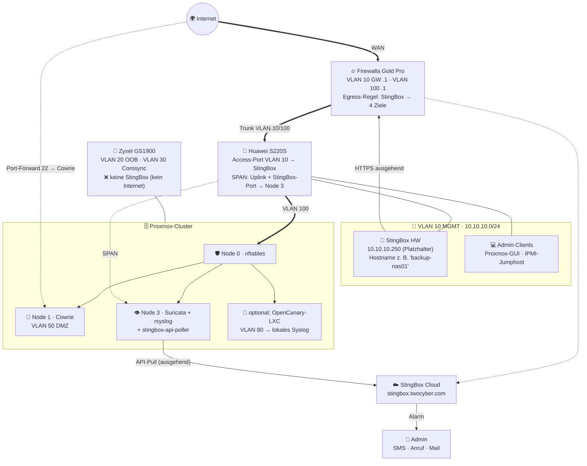
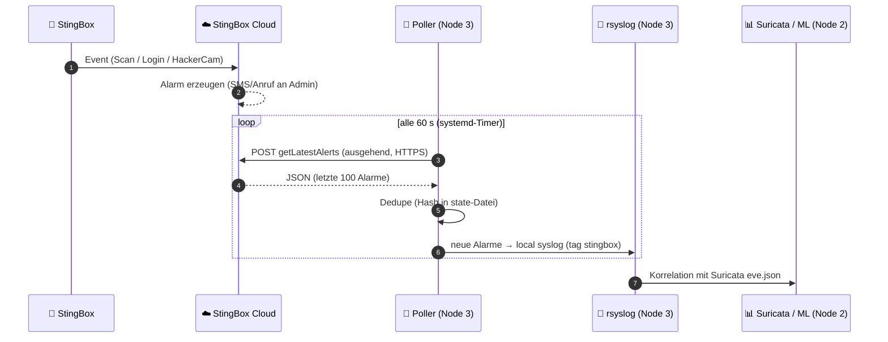

# 🔌 Integration ins node300-Lab

> Zurück zur [README](../README.md) · [🐝 Was es ist](what-it-is.md) · [🚫 Was es nicht ist](what-it-is-not.md) · [🎯 Für wen?](who-should-buy.md) · [🔁 Alternativen](alternatives.md) · [🔍 Reality Check](reality-check.md)

> [!CAUTION]
> Alles hier ist ein **Planungs- und Beispieldokument** ⚠️. Wir haben **keine** StingBox im Lab getestet. IPs sind Platzhalter aus dem VLAN-Plan der Companion-Repos; Switch-Syntax ist **nicht am Huawei S220S verifiziert**; das API-Antwortformat ist **nicht vollständig dokumentiert** ([API-Doku](https://stingbox.twocyber.com/api_doc/StingBoxAPIDocumentation.pdf)).

**Ausgangslage** (aus den Companion-Repos):

| Komponente | Rolle | Quelle |
|---|---|---|
| 🔥 Firewalla Gold Pro | Perimeter, VLAN 10 + 100 Gateway, IDS/IPS | [firewalla-gold-pro-msp](https://github.com/node300-net/firewalla-gold-pro-msp) |
| 🔀 Huawei S220S | 10G-Core, Trunks, SPAN → Node 3 | [firewalla-gold-pro-msp → VLAN-Plan](https://github.com/node300-net/firewalla-gold-pro-msp/blob/main/configs/network/vlan-plan.md) |
| 🧰 Zyxel GS1900 | OOB/IPMI (VLAN 20), Corosync (VLAN 30) – **nicht geroutet** | [sovereign-datacenter](https://github.com/node300-net/sovereign-datacenter) |
| 🛡️ Node 0 SEC-CORE | nftables, Gateway VLAN 50/60/80 | [sovereign-datacenter](https://github.com/node300-net/sovereign-datacenter) |
| 🍯 Node 1 DEFENSE | **Cowrie** im DMZ-VLAN 50, Internet-exponiert via Port-Forward | [sovereign-datacenter](https://github.com/node300-net/sovereign-datacenter) |
| 👁️ Node 3 MONITOR | **Suricata** via SPAN, zentrales **Syslog** | [sovereign-datacenter](https://github.com/node300-net/sovereign-datacenter) |

---

## 🧠 Kernidee: Zwei Honeypots, zwei völlig verschiedene Jobs

| | 🍯 Cowrie (Node 1) | 🐝 StingBox / OpenCanary (intern) |
|---|---|---|
| Wo? | **DMZ, vom Internet erreichbar** | **Innen**, im Management-/Server-Netz |
| Wer klopft? | Botnetze, Scanner – **tausende Male pro Tag** ⚠️ | **Niemand** – ausser ein Angreifer ist schon drin |
| Was ist der Wert? | **Threat Intel**: Passwörter, Tools, TTPs | **Alarm**: „Jemand bewegt sich lateral“ |
| Alarm aufs Handy? | ❌ Nein (wäre Dauerrauschen) | ✅ **Ja, sofort** |

> 💡 **Didaktischer Kernpunkt:** Ein Honeypot im Internet **sammelt**, ein Honeypot im LAN **warnt**. Die StingBox (oder ihr Open-Source-Pendant) ergänzt Cowrie also – sie ersetzt sie nicht und umgekehrt.

---

## 🌐 Zieltopologie



---

## 📍 Platzierung – VLAN für VLAN

| VLAN | Name | StingBox? | Begründung |
|---|---|---|---|
| **10** | MGMT | ✅ **Ja (Favorit)** | Hier haben Angreifer das grösste Interesse (Proxmox-GUI, Switches, IPMI-Jumphost). Legitim spricht niemand mit der Box → **jede** Verbindung ist ein echter Alarm. Firewalla ist Gateway → Egress kontrollierbar. ⚠️ Gegenargument: Vertrauen in Hersteller-Updates/SSH-Key ([RC-5](reality-check.md#rc-5)) – du holst ein fremdgesteuertes Gerät ins sensibelste Netz. |
| **20** | OOB (Zyxel) | ❌ | Nicht geroutet, **kein Internet** → StingBox funktioniert nicht. Internet freizuschalten würde die OOB-Isolation brechen. Alternative: 🐤 OpenCanary mit lokalem Log (⚠️ Logabholung über Jumphost planen). |
| **30 / 40** | Corosync / Storage | ❌ | Nicht geroutet, latenzkritisch, kein Internet. |
| **50** | DMZ-HONEY | ⚠️ optional | Cowrie ist emuliert → echte Lateral-Bewegung aus Cowrie heraus ist nicht zu erwarten. Geringer Mehrwert. |
| **60** | LAB-REDTEAM | ❌ | **Internet BLOCK** (by design) + Red-Team-Übungen = Dauer-Fehlalarm. Höchstens als **Übungsziel**, dann aber OpenCanary. |
| **70** | SPAN | ❌ | Reines Mirror-Ziel. |
| **80** | ANALYTICS | ⚠️ möglich | Als **StingBox Virtual** (VM) oder OpenCanary-LXC. Node 0 ist Gateway → Egress per nftables. |
| **100** | WAN-TRANSIT | ❌ | /29 Transfernetz, kein Endgerät. |

---

## 🧭 Drei Varianten

| Variante | Was | Pro | Contra | Kosten |
|---|---|---|---|---|
| **A 🐤 OpenCanary-LXC** (empfohlen) | OpenCanary in VLAN 10 **oder** 80, Log → Node 3 rsyslog | Gratis, keine Cloud, volle Kontrolle, gleiche Pipeline wie Suricata | Alarm aufs Handy selbst bauen (z. B. Webhook/SMTP-Handler) | 0 $ |
| **B 🐝 StingBox Hardware** | Physische Box an Huawei-Access-Port VLAN 10 | Echte separate Hardware (fällt bei Cluster-Ausfall nicht mit aus), SMS/Anruf out-of-the-box, MSP-Evaluation | Cloud, Mietgerät, 10/100, Hersteller-Key | 250 $ / Jahr 1, dann 200 $ ✅ ([Order](https://www.stingbox.com/order/)) |
| **C 🐝 StingBox Virtual** | Ubuntu-20.04-VM auf Proxmox, VLAN 80 | Keine Hardware, Snapshot/Backup möglich | `curl \| sudo bash`, EOL-Basis-OS, läuft auf dem Cluster, den sie bewachen soll | 200 $ / Jahr ✅ ([Virtual](https://www.stingbox.com/virtual/)) |

> 🧠 **Ehrliche Empfehlung fürs Lab:** **A** als Dauerlösung, **B** nur, wenn du StingBox **für MSP-Kunden evaluieren** willst oder Anruf-Alarme ohne Eigenbau möchtest. **A + B parallel** im selben VLAN ist ein lehrreicher Vergleich (welcher Sensor meldet was, wie schnell?).

---

## 🔥 Firewalla Gold Pro: Egress nur das Nötigste

StingBox braucht **keine** eingehenden Ports und genau **vier** ausgehende Ziele ✅ ([FAQ](https://www.stingbox.com/faq/)). Firewalla und StingBox sind laut Hersteller kompatibel ✅ ([FAQ](https://www.stingbox.com/faq/)).

| # | Regel (Firewalla-App/MSP, Gerät „StingBox“) | Typ | Hinweis |
|---|---|---|---|
| 1 | Allow → `stingbox.twocyber.com` TCP 443 | Allow | Dashboard/Check-in |
| 2 | Allow → `checkip.amazonaws.com` TCP 443 | Allow | Externe IP |
| 3 | Allow → `mirrors.ocf.berkeley.edu` TCP 80/443 | Allow | Ubuntu-Updates ⚠️ Port nicht dokumentiert, Mirrors nutzen oft HTTP |
| 4 | DNS: **`resolv.txt` → `nameserver 10.10.10.1`** (Firewalla) statt 8.8.8.8 | Config | So greifen Firewalla-DNS-Features (Unbound/DoH) und Domain-Regeln ✅ ([FAQ – Custom DNS](https://www.stingbox.com/faq/)) |
| 5 | Block → **Internet** (alles andere) | Block | Firewalla priorisiert spezifischere Allow-Regeln ⚠️ Regel-Priorität in der App prüfen |
| 6 | Block → lokale Netze VLAN 50/60/80/100 | Block | Box soll nur ihr eigenes Segment sehen |

Maschinenlesbares Konzept: [`configs/firewalla-stingbox-rules.yaml`](../configs/firewalla-stingbox-rules.yaml).

**Überschneidungen mit Firewalla – bewusst entscheiden:**

| StingBox-Feature | Firewalla hat schon … | Empfehlung |
|---|---|---|
| WAN-Open-Port-Alarm | External Open Port Scan, Open-Port-(UPnP)-Alarm ✅ ([Firewalla](https://help.firewalla.com/hc/en-us/articles/48455312216595-Handling-Specific-Firewalla-Alarms)) | Doppelt hält besser – aber Port-Forward 22 → Cowrie wird **bei beiden** als „offen“ erscheinen → in StingBox akzeptieren |
| New-Device-Alarm | New Device + Quarantäne ✅ | In StingBox auf *Informational* setzen |
| SMB-Share-Scan | – | **Aus** (aktive Login-Versuche mit `root` stören Suricata und sind im MGMT-VLAN unnötig) |

---

## 🔀 Huawei S220S: Access-Port

```text
# ⚠️ Beispiel – Syntax NICHT am S220S verifiziert (VRP-Stil), Port-Nummer anpassen
interface GigabitEthernet0/0/10
 description DECOY-STINGBOX-VLAN10
 port link-type access
 port default vlan 10
 # optional: nur diese MAC am Port zulassen
 port-security enable
 port-security mac-address sticky
 port-security max-mac-num 1
```

- Box läuft mit **100 Mbit** ✅ ([White Paper](https://www.stingbox.com/wp-content/uploads/2024/06/Whitepaper-US-1.36-2021.pdf)) → Port auf Auto-Negotiation lassen.
- **Kein PoE** annehmen ([RC-10](reality-check.md#rc-10)) → Netzteil, ⚠️ 230-V-Tauglichkeit prüfen.
- **SPAN:** Den StingBox-Port **zusätzlich** als Mirror-Quelle zu Node 3 hinzufügen → Suricata sieht **jeden** Zugriff auf den Köder (eigener, cloudfreier Zweit-Alarm). ⚠️ Oversubscription-Hinweis aus dem [Firewalla-Companion](https://github.com/node300-net/firewalla-gold-pro-msp/blob/main/configs/integration/node3-suricata-syslog.md) beachten. Beispiel: [`configs/huawei-stingbox-port.example`](../configs/huawei-stingbox-port.example).

---

## 👁️ Node 3: Suricata + Syslog

### 1) StingBox-Alarme ins zentrale Syslog – per API-Pull



**Warum Pull statt Syslog/Webhook?** Syslog und Webhook werden sehr wahrscheinlich **aus der Cloud** zugestellt ⚠️ ([what-it-is.md §2.6](what-it-is.md#26--alerting--integrationen)) → Node 3 müsste aus dem Internet erreichbar sein (Port-Forward, eingehende Regel). Pull ist **nur ausgehend**, holt verpasste Alarme nach (Webhooks haben keinen Retry ✅ [FAQ](https://www.stingbox.com/faq/)) und passt zum Muster des Firewalla-MSP-Pollers im Companion-Repo.

```bash
# Node 3 – Platzhalter, Key niemals committen!
install -m 600 /dev/null /etc/stingbox/api_key && vi /etc/stingbox/api_key
python3 configs/stingbox-api-poller.py --once --dry-run      # zeigt, was gesendet würde
sudo cp configs/stingbox-api-poller.{service,timer} /etc/systemd/system/
sudo systemctl enable --now stingbox-api-poller.timer
```

Dateien: [`stingbox-api-poller.py`](../configs/stingbox-api-poller.py) · [`.service`](../configs/stingbox-api-poller.service) · [`.timer`](../configs/stingbox-api-poller.timer) · [`rsyslog-stingbox.conf`](../configs/rsyslog-stingbox.conf)

### 2) Suricata: Der Köder als kostenloser Zweit-Sensor

Wenn der StingBox-Port gespiegelt wird, kann Suricata selbst alarmieren – **unabhängig von der Cloud**:

```text
# configs/suricata-decoy.rules (⚠️ Beispiel, SIDs aus lokalem Bereich 9.000.000+)
alert tcp !$STINGBOX_IP any -> $STINGBOX_IP any (msg:"DECOY StingBox: TCP-SYN von intern"; flags:S,12; sid:9000101; rev:1;)
```

Volle Datei mit Ausnahmen: [`configs/suricata-decoy.rules`](../configs/suricata-decoy.rules).

### 3) Fehlalarme durch die StingBox selbst unterdrücken

Die Box scannt alle 5 Minuten ihr Subnetz ✅ ([FAQ](https://www.stingbox.com/faq/)) → Suricata-Scan-Signaturen (z. B. ET SCAN) werden auf **ihre** IP anschlagen.

```text
# /etc/suricata/threshold.config – ⚠️ SIDs der tatsächlich feuernden Regeln eintragen
suppress gen_id 1, sig_id <<SID_DER_SCAN_REGEL>>, track by_src, ip <<STINGBOX_IP>>
```

Alternativ LAN-Discovery im StingBox-Dashboard **abschalten** ✅ ([FAQ](https://www.stingbox.com/faq/)) – Firewalla liefert New-Device-Alarme ohnehin.

### 4) Whitelist in StingBox

Node 3 (falls aktive Scans), Schwachstellenscanner und Monitoring im **WhiteList IP Manager** eintragen ✅ ([FAQ](https://www.stingbox.com/faq/)) – sonst meldet der Köder deine eigenen Tools. **Aber:** jede Whitelist-IP ist ein blinder Fleck. Wird genau dieser Host kompromittiert, schweigt der Köder.

---

## 🍯 Zusammenspiel mit Cowrie (Node 1)

| Frage | Antwort |
|---|---|
| Ersetzt HackerCam Cowrie? | ❌ Nein. Cowrie ist tiefer (Fake-FS, Downloads speichern, Proxy-/LLM-Modus ✅ [Cowrie](https://github.com/cowrie/cowrie)) und lokal. |
| Ersetzt Cowrie die StingBox? | ⚠️ Teilweise: Ein **zweites** Cowrie intern (VLAN 10) auf SSH wäre ein guter Gratis-Tripwire – aber nur für SSH/Telnet. OpenCanary deckt mehr Protokolle ab. |
| Gemeinsame Pipeline? | ✅ Cowrie-JSON, Suricata-EVE und StingBox-Poller → **Node 3 rsyslog** → Node 2 ML |
| Gleiche Hostnamen-Strategie? | ✅ Köder glaubwürdig benennen (`backup-nas01`, `pve-old`), aber nie wie ein echtes System, das Admins wirklich ansprechen |

---

## ✅ Checkliste

- [ ] Datenschutz geklärt (DPA anfragen, [RC-3](reality-check.md#rc-3))
- [ ] Variante gewählt (A / B / C)
- [ ] IP reserviert (DHCP-Reservation auf Firewalla oder `eth0.txt` statisch) – Platzhalter `10.10.10.250`
- [ ] `resolv.txt` → Firewalla als DNS
- [ ] Firewalla-Egress-Regeln (4 Ziele, Rest Block)
- [ ] Huawei-Access-Port + optional Port-Security + SPAN-Quelle
- [ ] SMB-Scan **aus**, LAN-Discovery bewusst an/aus
- [ ] Whitelist minimal halten
- [ ] Alarmwege: SMS + Anruf (Critical), Mail (Important), Poller → Syslog (alle)
- [ ] **Test:** `ftp://10.10.10.250` aus VLAN 10 → Alarm? ✅ ([FAQ](https://www.stingbox.com/faq/)) · `nmap -sS` von Admin-Client → Alarm + Suricata-Decoy-Rule?
- [ ] Kündigungs-/Rückgabe-Reminder im Kalender ([RC-1](reality-check.md#rc-1))
