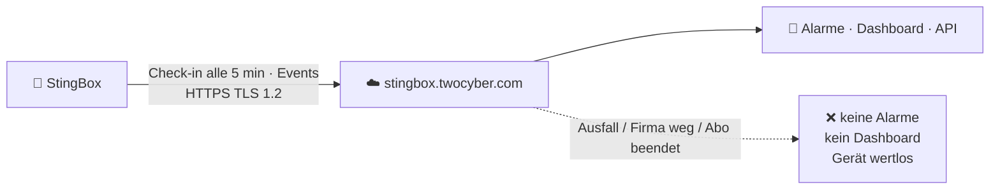

# 🔍 Reality Check – Grenzen, Risiken, Widersprüche

> Zurück zur [README](../README.md) · [🐝 Was es ist](what-it-is.md) · [🚫 Was es nicht ist](what-it-is-not.md) · [🎯 Für wen?](who-should-buy.md) · [🔁 Alternativen](alternatives.md) · [🔌 Integration](integration.md)

StingBox ist ein **vernünftiges, simples Produkt**. Genau deshalb gehört hier hin, was man vor dem Kauf wissen sollte. Dieses Dokument ist bewusst unbequem.

| Legende | |
|---|---|
| 🟢 | Unkritisch, nur Hinweis |
| 🟡 | Funktioniert mit Einschränkungen / Prüfung nötig |
| 🔴 | Harte Grenze – wenn dir das wichtig ist, ist StingBox die falsche Wahl |

---

## RC-1 🔴 Kein Kauf – du mietest ein Gerät

- **Fakt:** *„We only offer StingBox through a subscription.“* ✅ ([FAQ](https://www.stingbox.com/faq/))
- **Fakt:** *„At all times ownership of the StingBox devices shall remain with us“*; bei Kündigung müssen Geräte **sofort zurückgeschickt** werden, und *„your subscription is not terminated until all StingBox devices are received by us and you will continue to be charged for a new term“* ✅ ([Terms](https://www.stingbox.com/terms/))
- **Fakt:** Automatische Verlängerung; kein Refund für eine bereits begonnene Periode; Kündigung per E-Mail an Support ✅ ([Terms](https://www.stingbox.com/terms/)). Die FAQ verweist zusätzlich auf `stingbox.com/cancel` ✅ ([FAQ](https://www.stingbox.com/faq/)).
- 🟦 Ein Reddit-Nutzer berichtet, die Kündigung sei *„impossible“* gewesen und er habe seine Bank einschalten müssen ([r/msp](https://www.reddit.com/r/msp/comments/13vcp77/anyone_use_sting_box/)) – **⚠️ Einzelfall, nicht überprüfbar**, aber konsistent mit der strengen Rückgabeklausel.
- ✅ **Mitigation:** Jahresabo mit Kalender-Reminder; Rücksendung mit **Tracking** und Beleg; Kündigung schriftlich bestätigen lassen. Aus CH/FL: Rückversand in die USA + Zollformular einplanen ⚠️.

## RC-2 🔴 Vollständige Cloud-Abhängigkeit

- **Fakt:** Dashboard, Alarmversand und Updates laufen über `stingbox.twocyber.com` ✅ ([FAQ](https://www.stingbox.com/faq/)). Es gibt **kein lokales Alerting** und **kein Self-Hosting des Backends** ⚠️ (nirgends angeboten).
- **Fakt:** Default-DNS ist **8.8.8.8** (Google) ✅; änderbar per `resolv.txt` auf der SD-Karte ✅ ([FAQ](https://www.stingbox.com/faq/)).
- **Folge:** Strikte Egress-Firewall → vier Ziele freigeben (siehe [Integration](integration.md#-firewalla-gold-pro-egress-nur-das-nötigste)).
- **Folge:** Angreifer, die zuerst den **Internet-Ausgang** kappen oder den Cloud-Host per DNS blocken, legen den Alarm lahm. StingBox meldet zwar Disconnects ✅ ([Startseite](https://www.stingbox.com/)) – aber das ist dann ein „Gerät offline“-Alarm, kein Angriffsalarm.

## RC-3 🟡 Datenschutz & Datenstandort

- **Was erfasst wird** ✅ ([FAQ](https://www.stingbox.com/faq/)): Angriffs-Sessions (was getippt wurde), **externe IP**, offene Ports der externen IP, ggf. **Hostnamen und MAC-Adressen** aller entdeckten LAN-Geräte. Laut Setup-Seite zeigt das Dashboard *„a detailed network map that should be kept private“* ✅ ([Setup](https://www.stingbox.com/setup/)).
- **Wo:** *„Personal Data we collect may be stored and processed in the United States or any other country in which … Business Partners maintain facilities.“* ✅ ([Privacy](https://www.stingbox.com/privacy/)). Konkreter Cloud-Anbieter/Region: ⚠️ **nicht genannt** (nur *„third party providers … including cloud hosting services“*).
- **Verschlüsselung at rest:** *„will most often be encrypted both in transit and at rest“* ✅ – „most often“ ist keine Garantie.
- **Support-Zugriff:** Mit Kundenerlaubnis sieht ein Support-Agent **alle** Dashboard-Infos ✅ ([White Paper S. 7](https://www.stingbox.com/wp-content/uploads/2024/06/Whitepaper-US-1.36-2021.pdf)).
- **Website-Tracking:** Werbe-/Personalisierungs-Cookies von Partnern, kein „Do Not Track“ ✅ ([Privacy](https://www.stingbox.com/privacy/)).
- **DSGVO/DSG:** Die Privacy Policy sagt, für Transfers ausserhalb EU/EWR gebe es *„adequate safeguards … may include agreements incorporating the EU standard contractual clauses“* ✅ ([Privacy](https://www.stingbox.com/privacy/)). Ein öffentlich abrufbares **DPA/AVV** haben wir **nicht gefunden** ⚠️; die Schweiz (revDSG) wird nicht erwähnt ⚠️. → Für KMU/MSP in CH/FL/EU **vor** dem Einsatz DPA anfordern – Hostnamen, MACs und IPs der Kundengeräte sind personenbeziehbare Daten.

## RC-4 🟡 Schwache und (laut Doku) alte Plattform

| Punkt | Fakt | Bewertung |
|---|---|---|
| RAM / CPU | 512 MB, Cortex-A7 ✅ ([White Paper](https://www.stingbox.com/wp-content/uploads/2024/06/Whitepaper-US-1.36-2021.pdf)) | 🟢 reicht für einen Low-Interaction-Honeypot |
| Netzwerk | **10/100 Mbit** ✅ | 🟢 reicht für Alarme; 🟡 auffällig in einem 1/10G-Netz (Fingerprint) |
| OS | **Ubuntu 16.04.7** (2021) ✅ – Standard-Support endete **April 2021** ([Ubuntu Release Cycle](https://ubuntu.com/about/release-cycle)) | 🔴 falls noch aktuell; ⚠️ heutiger Stand **unbekannt** – beim Hersteller erfragen |
| Virtual | verlangt **Ubuntu 20.04** ✅ ([Virtual](https://www.stingbox.com/virtual/)) – Standard-Support endete **Mai 2025** ([Ubuntu Release Cycle](https://ubuntu.com/about/release-cycle)) | 🟡 VM isolieren |
| Malware-Schutz | „No specific malware protections“ ✅ | 🟢 bei einem Köder akzeptabel, wenn isoliert |
| Speicher | microSD ✅; FAQ: *„Sometimes the SD card gets jostled free“* ✅ | 🟡 SD-Karten altern; Ersatz laut White Paper durch Hersteller |
| White Paper | Version **1.36 vom Juni 2021** ist das aktuelle öffentliche Sicherheitsdokument ✅ | 🟡 5 Jahre alt |

## RC-5 🟡 Hersteller-SSH-Key auf dem Gerät

- **Fakt:** SSH auf Port **2222**, *„System only contains a public key which allows a stingbox administrator on the local network to troubleshoot the stingbox. No remote access from outside of a local network is established.“* ✅ ([White Paper S. 5](https://www.stingbox.com/wp-content/uploads/2024/06/Whitepaper-US-1.36-2021.pdf))
- **Bedeutung:** Wer den passenden **privaten Schlüssel** hat, kommt aus dem LAN als Admin auf die Box. Wer diesen Schlüssel besitzt und ob er **pro Gerät** oder **global** ist: ⚠️ **nicht dokumentiert**.
- **Zusätzlich:** Updates kommen automatisch vom Hersteller (*„Devices are updated automatically“* ✅) – der Hersteller kann also jederzeit Code auf der Box ausführen. Das ist bei Cloud-Appliances normal, aber gehört ins Bedrohungsmodell.
- ✅ **Mitigation:** Box in ein Segment, in dem sie **nichts Wertvolles erreicht**; Egress auf die 4 Ziele beschränken; Port 2222 nur aus dem Admin-Netz zulassen (sofern dein Switch/Firewall das zwischen Geräten im gleichen VLAN kann ⚠️).

## RC-6 🟡 Ein Interface – Discovery nur im eigenen Subnetz

- ✅ *„StingBox does not support multiple network interfaces.“* ([FAQ](https://www.stingbox.com/faq/))
- ✅ Honeypot-Funktion ist aus anderen VLANs nutzbar, solange **erreichbar**; Trunk-Port bringt *keine* zusätzliche Funktion ([FAQ](https://www.stingbox.com/faq/)).
- 🟦 *„you need a separate box for each vlan / subnet“* ([r/msp](https://www.reddit.com/r/msp/comments/13vcp77/anyone_use_sting_box/)).
- **Ehrliche Auflösung:** Für die **Honeypot-Funktion** reicht eine Box, wenn Angreifer sie aus anderen VLANs erreichen **und** scannen. Für **LAN-Discovery/New-Device** und für Scans **innerhalb** anderer VLANs brauchst du eine Box **pro Segment** → Kosten skalieren linear (200 $/Jahr/Segment).

## RC-7 🟡 Alert-Latenz und Zustellung

- ✅ FAQ: *„How often are alerts sent out? Every 10 minutes.“* – vs. Marketing *„Receive instant notifications“* ([Startseite](https://www.stingbox.com/)). ⚠️ Vermutlich gebündelter Versand → **bis zu ~10 Minuten Verzögerung** möglich (Ableitung).
- ✅ Webhooks werden *„only once, without repeats“* gesendet ([FAQ](https://www.stingbox.com/faq/)) → ist dein Empfänger kurz offline, ist der Alarm dort **weg** (im Dashboard/API bleibt er).
- ✅ Webhooks erlauben auch **unverschlüsseltes HTTP** ([FAQ](https://www.stingbox.com/faq/)) → nur HTTPS verwenden.
- ✅ Syslog nur **TCP**, ohne Angabe zu TLS ⚠️ ([FAQ](https://www.stingbox.com/faq/)).
- ✅ **Mitigation:** Primär SMS/Anruf + Mail; SIEM-Anbindung per **API-Pull** (idempotent, holt verpasste Alarme nach) – siehe [`configs/stingbox-api-poller.py`](../configs/stingbox-api-poller.py).

## RC-8 🟡 API-Design

- ✅ Der API-Key wird laut Doku als **URL-Parameter** übergeben (`?api_key=…`) bzw. als POST-Feld im Beispiel ([API-Doku](https://stingbox.twocyber.com/api_doc/StingBoxAPIDocumentation.pdf)). URL-Parameter landen gern in Proxy-/Server-Logs ⚠️.
- ✅ Nur 4 Aktionen, `getLatestAlerts` liefert die **letzten 100** – bei Alarmstürmen ⚠️ können ältere Alarme beim Pollen fehlen.
- ✅ **Mitigation:** Key als POST-Feld senden (wie im curl-Beispiel), Key in Datei mit `chmod 600`, kurzes Poll-Intervall.

## RC-9 🟡 Aktive Scans erzeugen Lärm – und sind „Angriffe“

- ✅ LAN-Discovery (Ping/ARP, laut White Paper TCP-SYN) alle 5 Minuten; optional SMB-Login als `root` mit leerem Passwort ([FAQ](https://www.stingbox.com/faq/)).
- 🟦 *„You can turn off Nmap which wreaks havoc with EDR, or you can whitelist it.“* ([r/msp](https://www.reddit.com/r/msp/comments/13vcp77/anyone_use_sting_box/))
- **Im node300-Lab:** Suricata (Node 3) und Firewalla-Alarme werden die StingBox selbst als Scanner melden → Suppress-Regeln nötig, siehe [Integration](integration.md).

## RC-10 🟡 Widersprüche in der Hersteller-Doku

| Thema | Aussage A | Aussage B |
|---|---|---|
| Interaktionstiefe | „low interaction honeypot“ ([Startseite](https://www.stingbox.com/)) | „high-interaction honeypot“ ([Virtual](https://www.stingbox.com/virtual/)) |
| PoE | „10/100M Ethernet RJ45 w/POE“ ([White Paper](https://www.stingbox.com/wp-content/uploads/2024/06/Whitepaper-US-1.36-2021.pdf)) | „Does the StingBox device support PoE? No“ ([FAQ](https://www.stingbox.com/faq/)) |
| Scan-Methode | Ping + arp-scan ([FAQ](https://www.stingbox.com/faq/)) | TCP-SYN-Scan ([White Paper](https://www.stingbox.com/wp-content/uploads/2024/06/Whitepaper-US-1.36-2021.pdf)) |
| LAN-Scan Standard? | Opt-out-Feature ([FAQ](https://www.stingbox.com/faq/)) | nur „if you have worked with support to enable Lan Scanning“ ([FAQ](https://www.stingbox.com/faq/)) |
| Alarmgeschwindigkeit | „instant notifications“ ([Startseite](https://www.stingbox.com/)) | „Every 10 minutes“ ([FAQ](https://www.stingbox.com/faq/)) |
| Kundenzahl | „over 1000 Organizations“ ([Startseite](https://www.stingbox.com/)) | „Trusted by 100s of IT Professionals“ ([Order](https://www.stingbox.com/order/)) |

> Keiner dieser Punkte ist ein Skandal – zusammen zeigen sie aber: **Doku ist nicht durchgehend gepflegt.** Vor dem Kauf konkrete Fragen schriftlich stellen.

## RC-11 🟡 Wenig unabhängige Evidenz & kleiner Anbieter

- Keine Labortests, keine Fachpresse, keine HN-Diskussion gefunden ⚠️ (Recherche 13.10.2026). Zwei der positiven Reviews entstanden in Kooperation mit dem Hersteller bzw. werden von ihm beworben ([what-it-is.md §8](what-it-is.md#8--unabhängige-stimmen-spärlich)).
- Pentest-Bericht nur unter **NDA** ✅ ([White Paper](https://www.stingbox.com/wp-content/uploads/2024/06/Whitepaper-US-1.36-2021.pdf)).
- Kleine Firma ⚠️ → Lieferanten-/Fortführungsrisiko. Bei Firmenende ist die Hardware ohne Cloud nutzlos ([RC-2](#rc-2)) – du verlierst aber auch nur das laufende Abo, nicht eine teure Investition.

## RC-12 🟢 Was ausdrücklich gut ist

- ✅ **Ehrliche Selbstbeschreibung** in der FAQ: „Does StingBox stop hackers? No.“ / „not a 100% guarantee“ – das ist seltener, als es sein sollte.
- ✅ **Klare Egress-Liste**, keine eingehenden Ports nötig.
- ✅ **Sinnvolle Integrationen** (CEF-Syslog, Webhook, API) für den Preis.
- ✅ **Sehr niedriger Einstieg** – auch Nicht-Techniker können es installieren.
- ✅ **Firewalla-Kompatibilität** explizit bestätigt ([FAQ](https://www.stingbox.com/faq/)).

---

## 🧾 Fragen, die du dem Hersteller vor dem Kauf stellen solltest

1. Welche **OS-Version** läuft aktuell auf Hardware und Virtual? Wann ist das nächste Plattform-Update?
2. Ist der **Support-SSH-Key** global oder pro Gerät? Kann ich ihn deaktivieren?
3. **Wo** genau (Anbieter/Region) werden Dashboard- und HackerCam-Daten gespeichert? Bekomme ich ein unterschriebenes **DPA/AVV** inkl. der in der Privacy Policy erwähnten **SCCs**?
4. Werden **Syslog/Webhooks** aus der Cloud oder vom Gerät gesendet? Syslog über **TLS**?
5. Welcher Dienst erzeugt die **KI-Zusammenfassung**, und verlassen Session-Daten dafür eure Infrastruktur?
6. Netzteil **230 V / EU-Stecker** bei Versand nach CH/FL?
7. Wie läuft die **Rücksendung** aus Europa, und wer trägt Versand/Zoll?
