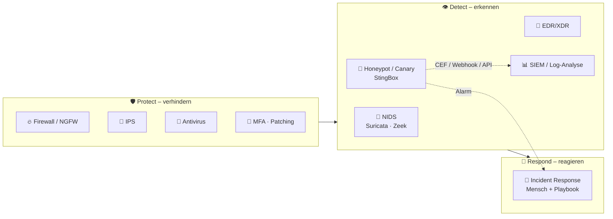

# 🚫 Was StingBox NICHT ist

> Zurück zur [README](../README.md) · [🐝 Was es ist](what-it-is.md) · [🎯 Für wen?](who-should-buy.md) · [🔁 Alternativen](alternatives.md) · [🔍 Reality Check](reality-check.md) · [🔌 Integration](integration.md)

Die häufigste Fehlentscheidung bei Security-Produkten ist ein **falsches mentales Modell**: „Ich habe jetzt X, also bin ich sicher.“ Diese Seite grenzt StingBox sauber ab. Legende: ✅ belegt · ⚠️ Ableitung/unverifiziert.

---

## 🗺️ Wo StingBox im Security-Stack sitzt

StingBox beschreibt sich selbst als Teil eines *„Protection, Detection and Response plan“* – und zwar **nur** im Detection-Teil ✅ ([FAQ](https://www.stingbox.com/faq/)).

---

## ❌ Die Abgrenzungen im Einzelnen

| # | StingBox ist **kein** … | Was das bedeutet | Beleg |
|---|---|---|---|
| 1 | 🔥 **Firewall** | Sitzt **nicht** im Datenpfad, filtert nichts, macht kein NAT/VPN | *„StingBox is not a replacement for good firewalls“* ✅ ([Virtual](https://www.stingbox.com/virtual/)); *„StingBox is a honeypot device while FireWalla is a firewall device.“* ✅ ([FAQ](https://www.stingbox.com/faq/)) |
| 2 | 🛑 **IPS / NIPS** | Blockiert keinen Angreifer, isoliert kein Gerät | *„Stingbox is not a NIPS (network intrusion prevention system) – just a Honeypot.“* ✅ · *„Does StingBox stop hackers? No.“* ✅ ([FAQ](https://www.stingbox.com/faq/)) |
| 3 | 📡 **Klassisches NIDS** (Suricata, Zeek, Snort) | Kein SPAN/TAP, keine Signaturen über fremden Verkehr. Sieht nur Verbindungen **zu sich selbst** und die Ergebnisse **eigener Scans** | ⚠️ Ableitung aus den Funktionsbeschreibungen ([White Paper](https://www.stingbox.com/wp-content/uploads/2024/06/Whitepaper-US-1.36-2021.pdf), [FAQ](https://www.stingbox.com/faq/)). Achtung: Das Marketing nutzt trotzdem Begriffe wie „Network Intrusion Detection“ ✅ |
| 4 | 🦠 **Antivirus** | Kein Agent auf Endgeräten, keine Datei-Scans | *„not a replacement for … anti-virus software“* ✅ ([Virtual](https://www.stingbox.com/virtual/)) |
| 5 | 🧬 **EDR / XDR** | Keine Prozess-/Host-Telemetrie, keine Isolation | *„We suggest having endpoint security for the devices on your network in addition to the StingBox.“* ✅ ([FAQ](https://www.stingbox.com/faq/)) |
| 6 | 📊 **SIEM** | Hat ein Dashboard für **eigene** Alarme, korreliert aber keine fremden Logs | Liefert **an** ein SIEM (CEF/Syslog, Webhook, API) ✅ ([FAQ](https://www.stingbox.com/faq/)) |
| 7 | 🔍 **Schwachstellenscanner** | Findet neue offene **WAN-Ports** und offene **SMB-Shares** – aber kein CVE-Scan, keine Patch-Bewertung | Funktionsliste ✅ ([Startseite](https://www.stingbox.com/), [FAQ](https://www.stingbox.com/faq/)); „kein CVE-Scan“ = ⚠️ nicht beworben, also nicht vorhanden angenommen |
| 8 | 📶 **WLAN-Wächter** | WLAN-Chip ist deaktiviert; erkennt fremde WLAN-Clients nur **indirekt** über „New Device“ im LAN | ✅ [White Paper](https://www.stingbox.com/wp-content/uploads/2024/06/Whitepaper-US-1.36-2021.pdf) · [FAQ](https://www.stingbox.com/faq/) |
| 9 | 🧪 **Forschungs-Honeypot / Threat-Intel-Sensor** | Gebaut als **interner Alarm**, nicht um Internet-Rauschen zu sammeln (dafür: T-Pot, Cowrie) | ⚠️ Einordnung; Platzierungsempfehlung „router, switch, open jack“ ✅ ([FAQ](https://www.stingbox.com/faq/)) |
| 10 | 🧾 **Compliance-Nachweis „nicht gehackt“** | Keine Alarme ≠ keine Kompromittierung | *„If I have no alerts … am I guaranteed not to have been hacked? No“* ✅ ([FAQ](https://www.stingbox.com/faq/)) |
| 11 | 🏠 **Gekauftes Eigentum** | Gerät bleibt **Eigentum von StingBox** | ✅ ([Terms](https://www.stingbox.com/terms/)) |
| 12 | 🔌 **Offline-fähig** | Ohne Cloud keine Alarme, kein Dashboard | ⚠️ Ableitung aus Architektur (Alarme laufen über `stingbox.twocyber.com`, [FAQ](https://www.stingbox.com/faq/)) |

---

## 🧠 Merksatz

> **Firewall** = Türschloss · **IPS** = Türsteher · **EDR** = Wachmann in jedem Raum · **NIDS** = Videoüberwachung im Flur · **StingBox** = **eine präparierte Schublade**, die Alarm schlägt, wenn jemand sie öffnet.
>
> Die Schublade ist wertvoll, **weil** ein Einbrecher sie fast immer öffnet, wenn er sich umsieht. Aber sie hält niemanden auf – und wer zielgerichtet in **einen** Raum geht, ohne zu stöbern, löst sie nie aus.

## ✅ Was du statt / zusätzlich brauchst

| Bedarf | Typische Lösung | Im node300-Lab |
|---|---|---|
| Verkehr filtern | Firewall | 🔥 Firewalla Gold Pro + nftables auf Node 0 ([Companion](https://github.com/node300-net/firewalla-gold-pro-msp)) |
| Angriffe blockieren | IPS | Firewalla Active Protect / Suricata (Gold Pro) |
| Verkehr analysieren | NIDS | 👁️ Suricata auf Node 3 via SPAN ([Companion](https://github.com/node300-net/sovereign-datacenter)) |
| Endgeräte schützen | EDR / AV | ⚠️ ausserhalb des Scopes dieses Repos |
| Alles korrelieren | SIEM / Syslog | Node 3 Syslog |
| **Lateral Movement früh bemerken** | **Honeypot / Canary** | 🐝 StingBox **oder** OpenCanary/Canarytokens → [Integration](integration.md) |
