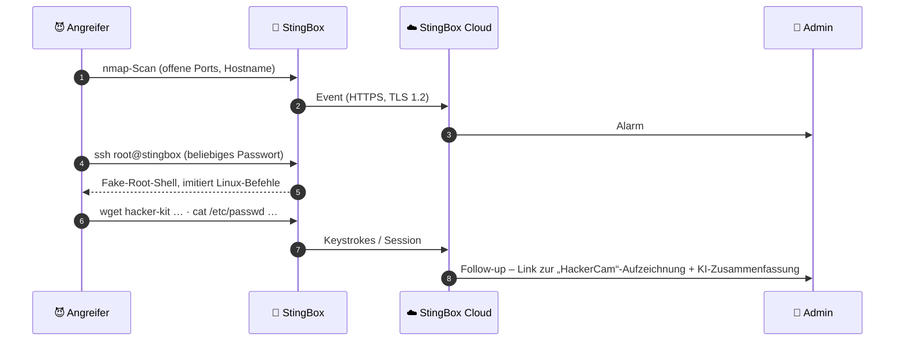

# 🐝 Was StingBox ist

> Zurück zur [README](../README.md) · [🚫 Was es nicht ist](what-it-is-not.md) · [🎯 Für wen?](who-should-buy.md) · [🔁 Alternativen](alternatives.md) · [🔍 Reality Check](reality-check.md) · [🔌 Integration](integration.md)

Recherchestand **13.10.2026**. Legende: ✅ Herstellerquelle · 🟦 unabhängige Quelle · ⚠️ unverifiziert/veraltet/Ableitung.

---

## 1. 🧠 Die Idee in 60 Sekunden: Honeypot = Einbruchmelder

Ein **Honeypot** ist ein Köder-System, das **keinen echten Zweck** im Netz hat. Weil legitim niemand mit ihm spricht, ist **jede** Verbindung verdächtig. Das macht ihn zum Gegenteil eines klassischen IDS:

| | 👁️ IDS (z. B. Suricata) | 🐝 Honeypot (z. B. StingBox) |
|---|---|---|
| Was wird beobachtet? | **Aller** Verkehr (via SPAN/TAP oder inline) | **Nur** Verkehr **an den Köder** |
| Wie wird erkannt? | Signaturen, Anomalien | „Irgendwer hat geklingelt“ |
| Fehlalarme | Viele, braucht Tuning | Wenige (wenn richtig platziert) |
| Blinde Flecken | Verschlüsselter Verkehr, unbekannte TTPs | Angreifer, die den Köder **nie anfassen** |
| Aufwand | Hoch (Rules, Hardware, Analyst) | Gering |

StingBox selbst nutzt dieses Bild: *„similar to a building alarm system which does not stop burglars but only detects them“* ✅ ([FAQ](https://www.stingbox.com/faq/)). Das MSP-Marketing nennt es explizit ein Produkt, das Kunden als „burglar alarm“ verstehen ✅ ([MSP](https://www.stingbox.com/msp/)).

> 🍯 **Low vs. High Interaction:** Ein *Low-Interaction*-Honeypot **emuliert** Dienste oberflächlich (Banner, Login-Prompt) – billig und sicher, aber für erfahrene Angreifer erkennbar. Ein *High-Interaction*-Honeypot ist ein **echtes** (überwachtes) System – realistischer, aber riskanter. StingBox nennt sich auf der Startseite **„low interaction“** ✅ ([Startseite](https://www.stingbox.com/)), die Virtual-Seite dagegen **„high-interaction honeypot“** ⚠️ ([Virtual](https://www.stingbox.com/virtual/)). Die technische Beschreibung (emulierte Dienste, Fake-Shell) spricht für **Low/Medium Interaction** ⚠️ (unsere Einordnung).

---

## 2. ⚙️ Funktionen im Detail

### 2.1 Honeypot-Dienste

- **Emulierte Dienste:** *„Set of services which simulate standard services of a networked host/device (FTP, SMB, etc)“* ✅ ([White Paper 2021, S. 5](https://www.stingbox.com/wp-content/uploads/2024/06/Whitepaper-US-1.36-2021.pdf))
- **Erscheinungsbild:** *„appears and responds to a hacker like an unsecured server“*; Hostname ist im Dashboard frei wählbar ✅ ([Startseite](https://www.stingbox.com/), [FAQ – HackerCam](https://www.stingbox.com/faq/))
- **Selbsttest:** `ftp://<STINGBOX-IP>` im Browser öffnen → Alarm „FTP scan attempt“ ✅ ([FAQ](https://www.stingbox.com/faq/))
- **Software-Basis:** Als Drittsoftware nennt das White Paper **Python Twisted 18.4.0** ✅. Ob StingBox auf einem bekannten Open-Source-Honeypot (z. B. OpenCanary, ebenfalls Twisted-basiert) aufbaut, ist **⚠️ nicht belegt** – Community-Nutzer vergleichen es lediglich damit 🟦 ([Spiceworks](https://community.spiceworks.com/t/stingbox/828286)).
- **Liste aller emulierten Ports/Dienste:** ⚠️ nicht öffentlich dokumentiert („Various“ im White Paper).

### 2.2 🎥 HackerCam

- Fake-SSH: Jedes Passwort wird akzeptiert, Standard-Linux-Befehle werden imitiert, alles wird aufgezeichnet und als **abspielbarer Link** verschickt ✅ ([FAQ](https://www.stingbox.com/faq/)).
- **KI-Zusammenfassung** des Vorfalls ✅ ([Startseite](https://www.stingbox.com/)) – welches Modell/welcher Anbieter das macht und wo die Session-Daten dafür verarbeitet werden: ⚠️ **nicht dokumentiert**.
- Für den Test empfiehlt StingBox `ssh -oHostKeyAlgorithms=+ssh-rsa -oPubkeyAcceptedAlgorithms=+ssh-rsa root@…` ✅ ([FAQ](https://www.stingbox.com/faq/)) – ein Hinweis darauf, dass der Fake-SSH-Dienst nur den alten `ssh-rsa`-Host-Key-Algorithmus anbietet ⚠️ (Ableitung). Ein moderner OpenSSH-Client verweigert das standardmässig – und ein aufmerksamer Angreifer erkennt daran evtl. den Honeypot.
- Eine öffentliche Demo-Aufzeichnung verlinkt die Startseite (`stingbox.twocyber.com/threat2/account/attackplayer.php?...`) ✅.

### 2.3 🔎 LAN-Discovery & New-Device-Alarme

| Aspekt | Angabe | Quelle |
|---|---|---|
| Methode | **Ping-Scan + arp-scan** im lokalen Subnetz | [FAQ](https://www.stingbox.com/faq/) ✅ |
| Methode (2021) | „Scanning is done via TCP syn scanning“ | [White Paper S. 7](https://www.stingbox.com/wp-content/uploads/2024/06/Whitepaper-US-1.36-2021.pdf) ✅ ⚠️ widerspricht FAQ teilweise |
| Intervall | **alle 5 Minuten**, nicht änderbar | [FAQ](https://www.stingbox.com/faq/) ✅ |
| Übertragene Daten | Hostnamen + MAC-Adressen → Cloud | [White Paper S. 5](https://www.stingbox.com/wp-content/uploads/2024/06/Whitepaper-US-1.36-2021.pdf) · [FAQ](https://www.stingbox.com/faq/) ✅ |
| Abschaltbar | Ja („optional feature … enable/disable“) | [FAQ](https://www.stingbox.com/faq/) ✅ |
| Nebenwirkung | Kann **andere Monitoring-Tools/EDR** alarmieren | [FAQ](https://www.stingbox.com/faq/) ✅ · 🟦 Reddit: *„You can turn off Nmap which wreaks havoc with EDR“* ([r/msp](https://www.reddit.com/r/msp/comments/13vcp77/anyone_use_sting_box/)) |

> ⚠️ Kleiner Widerspruch: Die FAQ zu „What information does StingBox collect?“ sagt, Hostnamen/MACs würden nur erfasst, *„if you have worked with support to enable Lan Scanning“*; andere FAQ-Einträge beschreiben die Discovery als Standardverhalten mit Opt-out. Vor dem Einsatz im Dashboard prüfen.

### 2.4 📂 SMB-Share-Scan (opt-in)

StingBox versucht sich an SMB-Freigaben im Netz **als `root` mit leerem Passwort** anzumelden, um offene Shares zu finden ✅ ([FAQ](https://www.stingbox.com/faq/)). Das ist eine **aktive Aktion** gegen deine Geräte → in Umgebungen mit EDR/IDS gibt es Alarme, und in regulierten Umgebungen sollte das mit dem Kunden abgesprochen sein.

### 2.5 🌍 WAN-Open-Port-Alarm

*„If a new external open port is detected on your public facing network, StingBox detects and alerts you“* ✅ ([Startseite](https://www.stingbox.com/)). Die externe IP ermittelt die Box über `checkip.amazonaws.com` ✅ ([FAQ](https://www.stingbox.com/faq/)); der Scan selbst erfolgt laut Firmenbeschreibung durch den **StingBox-Service** (*„StingBox service scans the WAN IP“*) 🟦 ([LinkedIn-Firmenprofil](https://www.linkedin.com/company/stingbox)) – also **von aussen**, aus der Cloud ⚠️ (Detail nicht in der FAQ).

### 2.6 🚨 Alerting & Integrationen

| Kanal | Details | Quelle |
|---|---|---|
| 📧 E-Mail / 💬 SMS / 📞 Sprachanruf | Mehrere Empfänger, pro Schweregrad konfigurierbar | [Startseite](https://www.stingbox.com/) · [FAQ](https://www.stingbox.com/faq/) ✅ |
| 🪝 Webhook | `POST` mit JSON (`severity`, `message`, `timestamp`, `stingbox_code`, `stingbox_name`, `stingbox_software_version`, `cef`); **einmalig, ohne Retry**; HTTP **oder** HTTPS erlaubt | [FAQ](https://www.stingbox.com/faq/) ✅ |
| 📜 Syslog | **nur TCP**, Ziel `<ip>:<port>`, Format **CEF** | [FAQ](https://www.stingbox.com/faq/) ✅ |
| 🔌 API | 1 Endpoint, Aktionen `getStingBoxDetails`, `getLatestAlerts` (letzte 100), `getActiveHosts` (24 h), `getOpenPorts` (24 h); API-Key als Parameter | [API-Doku Jan. 2026](https://stingbox.twocyber.com/api_doc/StingBoxAPIDocumentation.pdf) ✅ |
| 🎚️ Schweregrade | Critical · Important · Informational | [FAQ](https://www.stingbox.com/faq/) ✅ |
| 🙈 Whitelist | IPs (z. B. Schwachstellenscanner) von Alarmen ausnehmen | [FAQ](https://www.stingbox.com/faq/) ✅ |
| ⏱️ Versandtakt | *„How often are alerts sent out? Every 10 minutes.“* | [FAQ](https://www.stingbox.com/faq/) ✅ ⚠️ steht im Kontrast zu „instant notifications“ auf der Startseite |
| 🔌 Offline-Alarm | Alarm bei Verbindungsverlust | [Startseite](https://www.stingbox.com/) ✅ |

> ⚠️ Ob Syslog und Webhook **von der Box im LAN** oder **aus der StingBox-Cloud** gesendet werden, ist nicht explizit dokumentiert. Da sie im Web-Dashboard konfiguriert werden und Alarme dort entstehen, ist **Cloud-Versand wahrscheinlich** – dann müsste dein Syslog-Server **aus dem Internet erreichbar** sein. Für das Lab empfehlen wir deshalb den **API-Pull** (nur ausgehend), siehe [Integration](integration.md).

---

## 3. 🔩 Hardware (Stand White Paper 2021)

| Bauteil | Angabe | Quelle | Status |
|---|---|---|---|
| SoC | **Allwinner H2**, Quad-Core Cortex-A7 | [White Paper S. 4](https://www.stingbox.com/wp-content/uploads/2024/06/Whitepaper-US-1.36-2021.pdf) | ✅ |
| RAM | **512 MB DDR3** | White Paper · [FAQ](https://www.stingbox.com/faq/) | ✅ |
| Storage | 8 GB microSD („TF card“) + 2 MB SPI-Flash | White Paper | ✅ |
| LAN | **10/100 Mbit** RJ45 | White Paper | ✅ |
| WLAN | XR819 802.11 b/g/n, **deaktiviert** | White Paper | ✅ |
| PoE | White Paper: „w/POE“ · FAQ: **„No“**, empfiehlt Micro-USB-PoE-Splitter | White Paper vs. [FAQ](https://www.stingbox.com/faq/) | ⚠️ widersprüchlich → **kein PoE annehmen** |
| Strom | Mitgeliefertes Ladegerät, „any 110v outlet“ | [Setup](https://www.stingbox.com/setup/) | ✅ · ⚠️ 230-V-Tauglichkeit/Stecker für CH/FL nicht angegeben |
| Konfiguration | Statische IP/DNS über Textdateien auf der **SD-Karte** (`eth0.txt`, `resolv.txt`) | [FAQ](https://www.stingbox.com/faq/) | ✅ |
| Debug | USB-Port schreibt Debug-Datei auf USB-Stick; LEDs zur Diagnose | [Setup](https://www.stingbox.com/setup/) | ✅ |
| Herkunft | „Made in the USA from Imported Parts“ | [Order](https://www.stingbox.com/order/) | ✅ |
| Board-Modell | Die Spezifikation (H2+/XR819/10/100/512 MB) entspricht einem **Orange Pi Zero** | Vergleich mit [linux-sunxi.org](https://linux-sunxi.org/Orange_Pi_Zero) | ⚠️ **unsere Ableitung**, vom Hersteller nicht bestätigt |

## 4. 💽 Software & Betrieb

| Aspekt | Angabe | Quelle | Status |
|---|---|---|---|
| OS | **Ubuntu 16.04.7 LTS**, Kernel 5.3.5+ armv7l | [White Paper S. 4](https://www.stingbox.com/wp-content/uploads/2024/06/Whitepaper-US-1.36-2021.pdf) | ✅ Stand 2021 · ⚠️ aktuell unbekannt |
| Updates | „Unattended and automatic upgrades“, Ubuntu-Mirror `mirrors.ocf.berkeley.edu` | White Paper · [FAQ](https://www.stingbox.com/faq/) | ✅ |
| Check-in | Alle 5 Minuten per Cron, HTTPS / TLS 1.2 | White Paper S. 7 | ✅ |
| Geräte-Identität | Schlüsselpaar-Datei pro Box (nur root lesbar) | White Paper S. 6 | ✅ |
| Lokaler Admin-Zugang | SSH auf Port **2222**, **kein Passwort-Login**, ein **Public Key** für einen „stingbox administrator on the local network“ | White Paper S. 5 | ✅ (siehe [RC-5](reality-check.md#rc-5)) |
| Malware-Schutz | „No specific malware protections“ | White Paper S. 6 | ✅ |
| Pentest | Externer Pentest: keine High/Critical, 1 Medium (CSRF) behoben; Bericht nur unter NDA | White Paper S. 8 · [FAQ](https://www.stingbox.com/faq/) | ✅ Herstellerangabe, ⚠️ nicht unabhängig einsehbar |
| End-of-Life | 1 Monat Vorankündigung, Ersatzgerät wird zugeschickt | White Paper S. 8 | ✅ |

## 5. ☁️ Cloud-Endpunkte (ausgehend)

| Ziel | Zweck | Quelle |
|---|---|---|
| `stingbox.twocyber.com` (HTTPS) | Dashboard-Backend, Check-in, Events | [FAQ](https://www.stingbox.com/faq/) ✅ |
| `8.8.8.8` (DNS) | Standard-DNS (änderbar via `resolv.txt`) | [FAQ](https://www.stingbox.com/faq/) ✅ |
| `checkip.amazonaws.com` (HTTPS) | Externe IP ermitteln | [FAQ](https://www.stingbox.com/faq/) ✅ |
| `mirrors.ocf.berkeley.edu` | Ubuntu-Updates (US-Mirror) | [FAQ](https://www.stingbox.com/faq/) ✅ |
| **Eingehend** | **Keine** Freigaben nötig | [FAQ](https://www.stingbox.com/faq/) ✅ |

## 6. 🖥️ StingBox Virtual

| Aspekt | Angabe | Quelle |
|---|---|---|
| Plattformen | Linux-Host, VPS, VM, AWS/GCP/Azure, Docker (privates Repo) | [Virtual](https://www.stingbox.com/virtual/) ✅ |
| Voraussetzungen | „New Full install of **Ubuntu 20.04 LTS**“, 8 GB Disk, 4 GB+ RAM | [Virtual](https://www.stingbox.com/virtual/) ✅ |
| Installation | `curl -sL https://stingbox.twocyber.com/install.php?stingboxkey=… \| sudo bash` als **root**, danach Reboot | [Virtual](https://www.stingbox.com/virtual/) ✅ |
| Interfaces | **nur ein** Netzwerkinterface | [FAQ](https://www.stingbox.com/faq/) ✅ |
| Preis | 25 $/Monat · 200 $/Jahr | [Virtual](https://www.stingbox.com/virtual/) ✅ |

> ⚠️ `curl | sudo bash` auf einer **frischen** Maschine ist das typische Muster: Die VM gehört danach faktisch dem Installer. → **Eigene, isolierte VM**, nie ein bestehender Server. Ubuntu 20.04 hat das Ende des Standard-Supports bereits erreicht (Mai 2025, [Ubuntu Release Cycle](https://ubuntu.com/about/release-cycle)) – ob neuere Versionen unterstützt werden: ⚠️ nicht dokumentiert.

## 7. 🏢 Firma

| Aspekt | Angabe | Quelle | Status |
|---|---|---|---|
| Rechtsform / Sitz | **StingBox LLC**, 7190 SE Federal Hwy Ste 3, Stuart, FL 34997, USA | [Kontakt](https://www.stingbox.com/contact/) · [Terms](https://www.stingbox.com/terms/) | ✅ |
| Frühere Adresse | 790 Juno Ocean Walk, Juno Beach, FL | [White Paper 2021](https://www.stingbox.com/wp-content/uploads/2024/06/Whitepaper-US-1.36-2021.pdf) | ✅ |
| Gründung | „co-founded in late 2019 by Michael Aiello and Paul Williams“ | [LinkedIn-Firmenprofil](https://www.linkedin.com/company/stingbox) (Selbstbeschreibung) | 🟦 / ⚠️ nicht unabhängig geprüft |
| Grösse | Sehr kleines Team ⚠️ (LinkedIn-Aggregatoren deuten auf eine einstellige Mitarbeiterzahl hin) | [LinkedIn](https://www.linkedin.com/company/stingbox) | ⚠️ unverifiziert |
| Backend-Domain | `twocyber.com` (Dashboard, API, Installer) | [FAQ](https://www.stingbox.com/faq/) · [API-Doku](https://stingbox.twocyber.com/api_doc/StingBoxAPIDocumentation.pdf) | ✅ · ⚠️ Verhältnis „TwoCyber“ ↔ StingBox LLC nicht dokumentiert |
| Kundenbasis | „Trusted by over 1000 Organizations“ / „deployed on 1000s of networks“ | [Startseite](https://www.stingbox.com/) · [Order](https://www.stingbox.com/order/) | ⚠️ Marketingangabe |
| Mitgliedschaft | MSPAlliance (Footer-Link) | [Startseite](https://www.stingbox.com/) | ✅ Link vorhanden · ⚠️ Status nicht geprüft |

## 8. 📰 Unabhängige Stimmen (spärlich!)

| Quelle | Datum | Tenor |
|---|---|---|
| [Lawrence Systems Forum](https://forums.lawrencesystems.com/t/stingbox-network-intrusion-alarm/6627) | Sept. 2020 | Neugier; Verweis auf OpenCanary; Skepsis gegenüber „locked“ |
| [Spiceworks](https://community.spiceworks.com/t/stingbox/828286) | März 2022 | „you can do that with opensource Linux (OpenCanary)“; Abo-Modell hinterfragt |
| [r/selfhosted](https://www.reddit.com/r/selfhosted/comments/10lcxc7/sting_box_alternative/) | Jan. 2023 | Suche nach Gratis-Alternative; Empfehlungen T-Pot, Thinkst |
| [r/msp](https://www.reddit.com/r/msp/comments/13vcp77/anyone_use_sting_box/) | ⚠️ ca. 2023 | Gemischt: „works well … performed well“ vs. „underwhelming“, „just nmap“, ein Nutzer berichtet von **Problemen beim Kündigen** (Einzelfall, ⚠️ unverifiziert) |
| DB Tech (YouTube-Review, [Spiegel auf Odysee](https://kp.odysee.tv/@dbtech:4/stingbox-network-intrusion-detection-and:a)) | ⚠️ ca. Okt. 2022 | Positiv; wird auf der StingBox-Seite zitiert. Ob das Gerät gestellt wurde: ⚠️ unbekannt |
| LinkedIn-Review 2024 | März 2024 | Positiv, **mit Dank an StingBox für die Gelegenheit** → nicht unabhängig ([Post](https://www.linkedin.com/feed/update/urn:li:activity:7174426718596706304)) |
| Hacker News | – | **Keine** Diskussionen gefunden (Suche via [hn.algolia.com](https://hn.algolia.com/?q=stingbox), 13.10.2026) |
| Fachpresse / Labortests | – | **Keine** gefunden ⚠️ |
