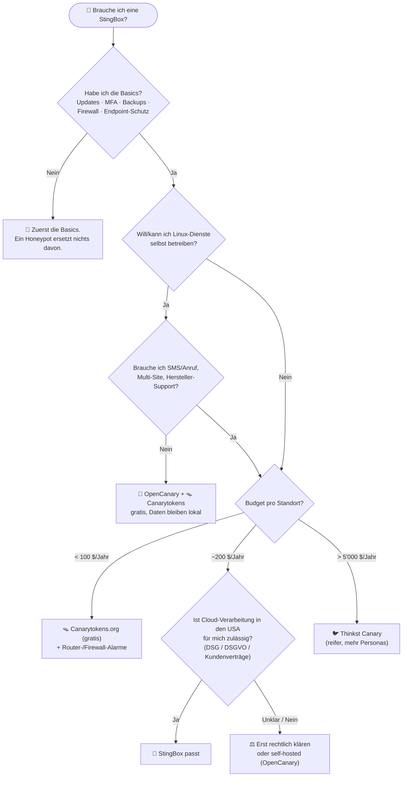

# 🎯 Für wen lohnt sich StingBox?

> Zurück zur [README](../README.md) · [🐝 Was es ist](what-it-is.md) · [🚫 Was es nicht ist](what-it-is-not.md) · [🔁 Alternativen](alternatives.md) · [🔍 Reality Check](reality-check.md) · [🔌 Integration](integration.md)

> [!NOTE]
> Die Urteile auf dieser Seite sind **unsere begründete Einschätzung** ⚠️ – keine Messung. Die zugrundeliegenden Fakten (Preis, Funktionen, Cloud-Pflicht) sind in [what-it-is.md](what-it-is.md) mit Quellen belegt. Preise: 200 $/Jahr bzw. 25 $/Monat + 50 $ Gerät ✅ ([Order](https://www.stingbox.com/order/)).

---

## 🌳 Entscheidungsbaum

---

## 👤 Persona 1: Privatnutzer (Single-Haushalt, ein paar Geräte)

| | |
|---|---|
| **Bedrohungsmodell** | Phishing, unsichere Passwörter, veraltete Router-Firmware, IoT-Geräte |
| **Was StingBox bringt** | Alarm, **falls** ein kompromittiertes Gerät das Heimnetz scannt; „New Device“-Info |
| **Was es nicht bringt** | Schutz gegen die häufigsten Angriffe (Phishing, Account-Übernahme) – die passieren **nicht** im LAN |
| **Kosten-Nutzen** | 250 $ im ersten Jahr für ein Ereignis, das selten eintritt |
| **Urteil** | ❌ **Eher nicht.** Starte mit [Canarytokens.org](https://canarytokens.org/) (gratis) z. B. als präparierte Datei „Passwörter.docx“ |

## 👨‍👩‍👧 Persona 2: Familie (viele Geräte, Kinder, Gäste, IoT)

| | |
|---|---|
| **Bedrohungsmodell** | Viele unverwaltete Geräte, Gäste-WLAN, Smart-Home |
| **Was StingBox bringt** | „New Device“-Alarme + Tripwire; leicht verständlich („Alarmanlage“) |
| **Achtung** | Alarm-Rauschen durch neue Geräte; ein IoT-Gerät, das „herumscannt“, kann Fehlalarme auslösen ⚠️ |
| **Bessere Hebel** | Gäste-/IoT-VLAN, Router mit Gerätealarmen (z. B. Firewalla „New Device“ + Quarantäne, [Firewalla-Doku](https://help.firewalla.com/hc/en-us/articles/48455312216595-Handling-Specific-Firewalla-Alarms)) |
| **Urteil** | ⚠️ **Selten sinnvoll.** Wenn schon eine Firewalla da ist, deckt sie „New Device“ bereits ab |

## 🧪 Persona 3: Homelabber

| | |
|---|---|
| **Bedrohungsmodell** | Exponierte Self-Hosted-Dienste, Experimente, eigenes Lernen |
| **Was StingBox bringt** | Null-Pflege-Tripwire mit SMS; „Great for my Home Lab!“ steht als Kundenstimme auf der Seite ✅ ([Order](https://www.stingbox.com/order/)) |
| **Was dagegen spricht** | Du lernst mehr, wenn du es selbst baust; Daten verlassen dein Netz; *„to run something at home for learning would be nice, not at $25/mo“* 🟦 ([r/selfhosted](https://www.reddit.com/r/selfhosted/comments/10lcxc7/sting_box_alternative/)) |
| **Alternative** | OpenCanary (Docker/LXC) + Cowrie + T-Pot → [alternatives.md](alternatives.md) |
| **Urteil** | ❌ / ⚠️ **Meist nicht** – ausser du willst explizit ein Fertigprodukt evaluieren |

## 🏢 Persona 4: KMU (Praxis, Kanzlei, Treuhand, 5–50 Mitarbeitende)

| | |
|---|---|
| **Bedrohungsmodell** | Ransomware nach Phishing → **Lateral Movement** im LAN → Verschlüsselung. Genau in der Lateral-Movement-Phase **scannen** Angreifer typischerweise |
| **Was StingBox bringt** | Einstecken, Telefonnummer hinterlegen, fertig ✅ ([Setup](https://www.stingbox.com/setup/)); **Anruf** statt nur Mail; Disconnect-Alarm; Branchenseiten für Banken, Kanzleien, Schulen ✅ ([Startseite](https://www.stingbox.com/)) |
| **Voraussetzung** | Jemand **reagiert** auf den Alarm (intern oder MSP) – sonst ist es ein teurer Rauchmelder ohne Feuerwehr |
| **Achtung** | US-Cloud + Netzwerkdaten (Hostnamen, MACs, IPs) → Datenschutz (DSG/DSGVO) prüfen; Mietgerät zurückgeben bei Kündigung ✅ ([Terms](https://www.stingbox.com/terms/)) |
| **Urteil** | ✅ **Sweet Spot** – günstiger, verständlicher Zusatzbaustein. Thinkst Canary ist reifer, aber ~7× teurer pro Gerät ✅ ([canary.tools](https://canary.tools/)) |

## 🧰 Persona 5: MSP / MSSP

| | |
|---|---|
| **Was StingBox bringt** | Ein Dashboard für viele Kunden, Gruppen mit eigenen Alarmregeln ✅ ([FAQ](https://www.stingbox.com/faq/)); White-Label ab 5 Stück ✅ ([MSP](https://www.stingbox.com/msp/)); API/Webhook/Syslog → RMM/SIEM ✅ |
| **Marketing-Versprechen** | „80+% margins“ ✅ ([MSP](https://www.stingbox.com/msp/)) – ⚠️ Herstellerbehauptung, abhängig von deinem Verkaufspreis |
| **Community-Erfahrung** | 🟦 „works well … We upsell to clients … For some clients, we add it at no cost.“ vs. 🟦 „underwhelming … separate box for each vlan / subnet“ ([r/msp](https://www.reddit.com/r/msp/comments/13vcp77/anyone_use_sting_box/)) |
| **Risiken** | Kleiner Anbieter (Lieferantenrisiko) ⚠️; EDR-Konflikte durch Netzwerk-Scans 🟦; Verträge: Auto-Renewal, Rückgabe-Pflicht ✅ ([Terms](https://www.stingbox.com/terms/)) |
| **Urteil** | ✅ **Passt**, besonders als **Einstiegs-Deception-Produkt** oder Sales-Tool („Wie oft wird Ihr Netz gescannt?“) ✅ ([MSP](https://www.stingbox.com/msp/)) |

## 🔴 Persona 6: Red Teamer

| | |
|---|---|
| **Sicht** | Der Honeypot ist **Gegner**, nicht Werkzeug |
| **Interessant** | Erkennbarkeit üben: Fake-SSH bietet laut FAQ-Testanleitung nur `ssh-rsa` an ⚠️ (Ableitung); 10/100-Link, ARM-Fingerprint, MAC-OUI des Boards ⚠️ |
| **Lehre** | Breite Scans (`nmap -sS 10.0.0.0/24`) lösen Honeypots aus → gezielte, passive Recon (ARP-Cache, DNS, AD-Abfragen) bevorzugen |
| **Urteil** | ⚠️ Nur als **Übungsziel** relevant. Für eigene Lab-Ziele ist OpenCanary/Cowrie flexibler |

## 🔵 Persona 7: Blue Teamer / SOC

| | |
|---|---|
| **Was zählt** | Kontrolle über Personas, Rohdaten, Integration, Datenhoheit |
| **StingBox** | CEF/Syslog, Webhook, simple API ✅ – aber kaum Konfigurierbarkeit der Dienste ⚠️, Daten in der Hersteller-Cloud |
| **Besser** | Thinkst Canary (kommerziell, viele Personas, Canarytokens-Server inkl.) oder OpenCanary (frei, voll steuerbar) |
| **Urteil** | ⚠️ **Funktioniert**, ist aber nicht die erste Wahl für ein reifes SOC |

---

## 📋 Zusammenfassung

| Persona | Urteil | Kernargument |
|---|---|---|
| 👤 Privatnutzer | ❌ | Kosten > Nutzen; Canarytokens gratis |
| 👨‍👩‍👧 Familie | ⚠️ | Router-Alarme und Segmentierung bringen mehr |
| 🧪 Homelabber | ❌ / ⚠️ | Selbst bauen = gratis + lehrreich |
| 🏢 KMU | ✅ | Plug-and-Play-Tripwire mit Anruf-Alarm |
| 🧰 MSP | ✅ | Multi-Tenant, White-Label, günstig |
| 🔴 Red Teamer | ⚠️ | Übungsgegner |
| 🔵 Blue Teamer | ⚠️ | Funktional, aber wenig Kontrolle |
| 🏛️ **node300-Lab** | ⚠️ **Nice-to-have** | Cowrie + Suricata decken viel ab → [integration.md](integration.md) |
